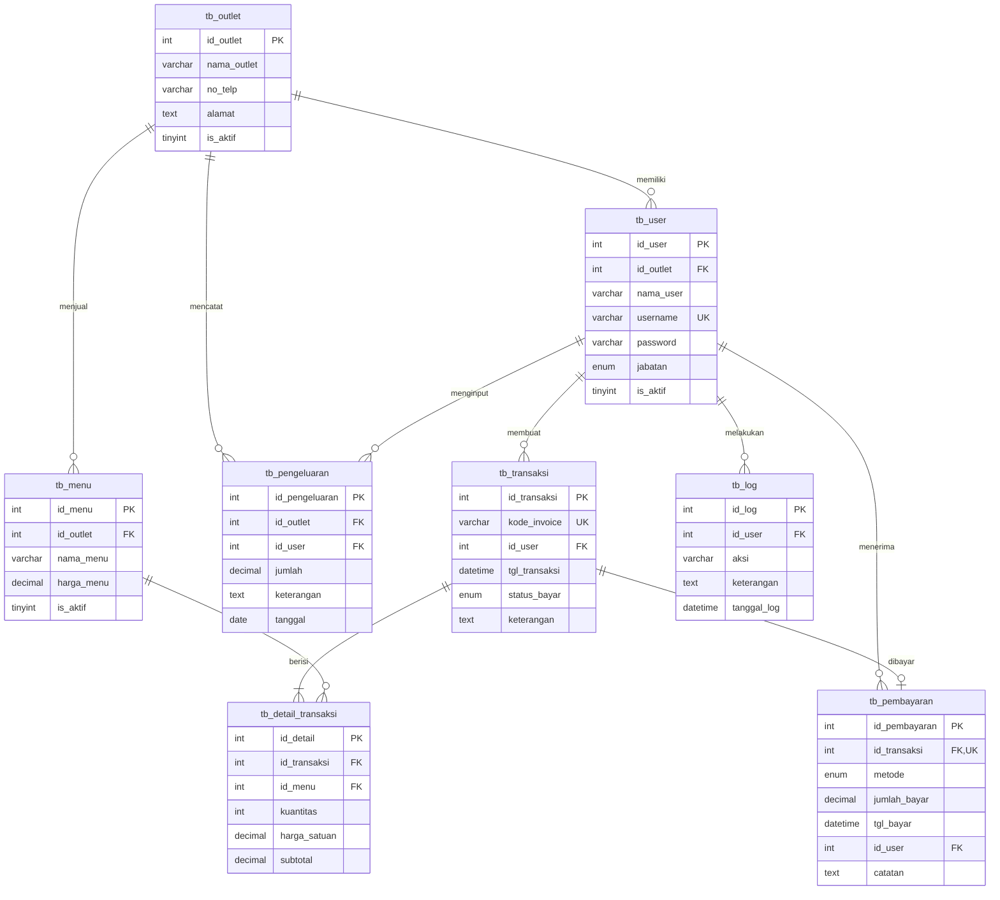

# Analisis Database — Sistem Informasi Telaga Rizqy 21

**Objek:** relasi tabel (ERD) Sistem Informasi Pengolahan Data Transaksi Keuangan
Berbasis Web pada Telaga Rizqy 21.
**Database:** `telaganzqy21` (MariaDB).
**Acuan:** ERD dan daftar kolom pada halaman perancangan TA (foto halaman 21.04.00).
**Tujuan analisis:** memeriksa 1NF–3NF, Primary Key, Foreign Key, redundansi/anomali,
lalu memperbaiki struktur agar konsisten dan siap dikembangkan.

> Catatan: nama sebagian kolom direkonstruksi dari foto/OCR. Kalau ada perbedaan
> dengan database asli di phpMyAdmin, sesuaikan nama kolomnya — polanya tetap sama.

---

## 1. Daftar Tabel dan Relasi

| No | Tabel | Fungsi | PK |
|---|---|---|---|
| 1 | `tb_outlet` | Data cabang/toko | `id_outlet` |
| 2 | `tb_user` | Akun admin & kasir | `id_user` |
| 3 | `tb_menu` | Produk/menu yang dijual | `id_menu` |
| 4 | `tb_transaksi` | Nota/penjualan | `id_transaksi` |
| 5 | `tb_pembayaran` | Pembayaran atas transaksi | `id_pembayaran` |
| 6 | `tb_pengeluaran` | Biaya operasional | `id_pengeluaran` |
| 7 | `tb_log` | Log aktivitas pengguna | `id_log` |

### Relasi yang terbentuk

```
tb_outlet  1 ──── N  tb_user          (id_outlet)
tb_outlet  1 ──── N  tb_menu          (id_outlet)
tb_menu    1 ──── N  tb_transaksi     (id_menu)
tb_user    1 ──── N  tb_transaksi     (id_user)
tb_transaksi 1 ─── 1/N tb_pembayaran  (id_transaksi)
tb_user    1 ──── N  tb_pembayaran    (id_user)
tb_outlet  1 ──── N  tb_transaksi     (id_outlet)   ← redundan
tb_outlet  1 ──── N  tb_pembayaran    (id_outlet)   ← redundan
tb_user    1 ──── N  tb_pengeluaran   (id_user)
tb_user    1 ──── N  tb_log           (id_user)
```

---

## 2. Pemeriksaan Primary Key (PK)

| Tabel | PK | Unik? | Status |
|---|---|---|---|
| `tb_outlet` | `id_outlet` | Ya (auto increment) | ✅ |
| `tb_user` | `id_user` | Ya | ✅ |
| `tb_menu` | `id_menu` | Ya | ✅ |
| `tb_transaksi` | `id_transaksi` | Ya | ✅ |
| `tb_pembayaran` | `id_pembayaran` | Ya | ✅ |
| `tb_pengeluaran` | `id_pengeluaran` | Ya | ✅ |
| `tb_log` | `id_log` | Ya | ✅ |

**Kesimpulan:** semua tabel sudah punya PK yang jelas dan sederhana (surrogate key).

**Kekurangan PK/alternate key:**
- `tb_user.username` **belum dijamin UNIQUE** → bisa ada dua akun dengan username sama.
- `tb_transaksi.kode_invoice` **belum dijamin UNIQUE** → nomor nota bisa dobel.
- `tb_pembayaran.id_transaksi` **belum dijamin UNIQUE** → satu transaksi bisa punya
  banyak baris pembayaran (padahal desainnya 1 transaksi = 1 pembayaran).
- `tb_menu` belum punya UNIQUE `(id_outlet, nama_menu)` → menu bisa dobel di satu outlet.

> PK hanya menjamin keunikan baris. **Candidate key** (username, kode invoice) tetap
> harus diberi `UNIQUE` agar data bisnis tidak duplikat.

---

## 3. Pemeriksaan Foreign Key (FK)

| No | Tabel anak | Kolom | Tabel induk | Status di ERD | Catatan |
|---|---|---|---|---|---|
| 1 | `tb_user` | `id_outlet` | `tb_outlet` | Ada | Wajib `NOT NULL` |
| 2 | `tb_menu` | `id_outlet` | `tb_outlet` | Ada | Wajib |
| 3 | `tb_transaksi` | `id_menu` | `tb_menu` | Ada | Akan dipindah ke detail |
| 4 | `tb_transaksi` | `id_user` | `tb_user` | Ada | Kasir pembuat |
| 5 | `tb_transaksi` | `id_outlet` | `tb_outlet` | Ada | **Redundan** |
| 6 | `tb_pembayaran` | `id_transaksi` | `tb_transaksi` | Ada | Perlu `UNIQUE` |
| 7 | `tb_pembayaran` | `id_user` | `tb_user` | Ada | Kasir penerima |
| 8 | `tb_pembayaran` | `id_outlet` | `tb_outlet` | Ada | **Redundan** |
| 9 | `tb_pengeluaran` | `id_user` | `tb_user` | Ada | OK |
| 10 | `tb_log` | `id_user` | `tb_user` | Ada | OK |

**Catatan penting:** ERD hanya menggambarkan relasi **logis**. Pada banyak project
CodeIgniter, constraint FK **belum benar-benar dibuat** di database. Kalau begitu:
- data anak bisa menunjuk induk yang tidak ada (orphan record);
- hapus induk tidak terkendali;
- tidak ada jaminan integritas referensial.

**Perbaikan:** buat FK fisik pada tabel InnoDB, tentukan aksi
`ON UPDATE CASCADE` dan `ON DELETE RESTRICT/SET NULL/CASCADE` sesuai kebutuhan.

---

## 4. Uji 1NF (First Normal Form)

**Syarat 1NF:**
1. Setiap kolom berisi nilai **atomik** (tidak bisa dipecah lagi).
2. Tidak ada **repeating group** / grup berulang dalam satu baris.
3. Setiap baris unik (ada PK).
4. Tiap kolom bertipe data konsisten.

### Temuan

| No | Lokasi | Temuan | Status |
|---|---|---|---|
| 1 | Semua tabel | Sudah punya PK dan kolom skalar | ✅ |
| 2 | `tb_transaksi` | Satu baris menampung **header nota + satu item** (`id_menu`, `kuantitas`). Kalau satu nota berisi beberapa menu, data item menjadi grup berulang yang dipaksa masuk ke satu baris. | ❌ **Melanggar 1NF** |
| 3 | `tb_outlet.alamat_outlet` | Alamat lengkap (jalan, RT/RW, kelurahan, kecamatan) disimpan dalam satu TEXT. Jika bagian alamat perlu di-query/direkap, ini atribut komposit. | ⚠️ Minor |
| 4 | `tb_log.isi_log` / `keterangan` | TEXT bebas; berpotensi menyimpan beberapa nilai sekaligus (JSON/serialized). | ⚠️ Potensial |
| 5 | Tanggal (`tgl_transaksi`, `tgl_pembayaran`, `tanggal_pengeluaran`, `tanggal_log`) | Disimpan `INT(11)`, bukan tipe tanggal. Bukan pelanggaran atomik, tetapi **domain/tipe data salah**. | ⚠️ Tipe data |
| 6 | `tb_pembayaran.kode_invoice` | Nilai yang sama juga ada di `tb_transaksi` → duplikasi nilai. | ⚠️ Redundansi |

**Contoh kasus nyata (poin 2):**
Satu pelanggan membeli 3 menu dalam satu nota. Dengan struktur sekarang, nota harus
dipecah menjadi 3 baris `tb_transaksi` dengan `kode_invoice` yang sama (atau dibuat
3 invoice berbeda). Akibatnya:
- header nota berulang (tanggal, kasir, status) → redundansi;
- total nota harus dihitung manual dari beberapa baris;
- rawan double counting saat laporan.

**Kesimpulan 1NF:** **belum terpenuhi** untuk transaksi multi-item. Perlu tabel detail.

---

## 5. Uji 2NF (Second Normal Form)

**Syarat 2NF:** sudah 1NF dan **tidak ada ketergantungan parsial** — setiap atribut
non-kunci bergantung pada **seluruh** kunci primer, bukan sebagian.

Karena semua tabel memakai PK satu kolom (`id_...`), secara formal tidak ada
ketergantungan parsial. **Namun** ada dua masalah tersembunyi:

| No | Tabel | Masalah | Status |
|---|---|---|---|
| 1 | `tb_transaksi` | Kunci alami transaksi sebenarnya adalah `(id_transaksi, id_menu)`. Dengan kunci itu, `id_outlet` hanya bergantung pada `id_menu` → **parsial**. PK surrogate menyembunyikan masalah ini. | ⚠️ |
| 2 | `tb_pembayaran` | `kode_invoice` bergantung pada `id_transaksi`, bukan pada `id_pembayaran` → satu nilai non-kunci bergantung pada atribut non-kunci lain (gejala parsial/transitif). | ⚠️ |

**Kesimpulan 2NF:** **lolos secara formal**, tetapi desainnya rapuh. Begitu kunci
alami dipakai, muncul ketergantungan parsial. Solusi strukturalnya: pisahkan
`tb_detail_transaksi` (header–detail), sehingga `tb_transaksi` benar-benar hanya
menyimpan data header.

---

## 6. Uji 3NF (Third Normal Form)

**Syarat 3NF:** sudah 2NF dan **tidak ada ketergantungan transitif** — atribut
non-kunci tidak boleh menentukan atribut non-kunci lain.

### Functional Dependency (FD) yang terbentuk

```
tb_transaksi
  id_transaksi → kode_invoice, id_user, id_menu, kuantitas,
                 status_bayar, tgl_transaksi, keterangan, id_outlet
  id_menu      → id_outlet, harga_menu          ← menentukan id_outlet
  id_user      → id_outlet                      ← menentukan id_outlet
  id_transaksi → id_outlet                      ← TRANSITIF (dua jalur di atas)

tb_pembayaran
  id_pembayaran    → id_transaksi, total_pembayaran, jumlah_uang_dibayar,
                     kembalian, tgl_pembayaran, kode_invoice, id_user, id_outlet
  id_transaksi     → kode_invoice, id_outlet    ← TRANSITIF
  jumlah_uang_dibayar, total_pembayaran → kembalian  ← TURUNAN
  detail_transaksi → total_pembayaran           ← TURUNAN

tb_menu
  id_menu → nama_menu, harga_menu, id_outlet    ← OK (id_outlet hanya FK)

tb_user
  id_user → nama_user, username, password, jabatan, id_outlet  ← OK
```

### Pelanggaran 3NF

| No | Tabel.Kolom | Jenis | Penjelasan | Perbaikan |
|---|---|---|---|---|
| 1 | `tb_transaksi.id_outlet` | Transitif | `id_transaksi → id_menu → id_outlet` dan `id_transaksi → id_user → id_outlet` | Hapus; ambil via JOIN |
| 2 | `tb_pembayaran.id_outlet` | Transitif | `id_pembayaran → id_transaksi → id_outlet` | Hapus |
| 3 | `tb_pembayaran.kode_invoice` | Transitif | `id_pembayaran → id_transaksi → kode_invoice` | Hapus; JOIN ke transaksi |
| 4 | `tb_pembayaran.kembalian` | Turunan | `kembalian = jumlah_uang_dibayar − total_pembayaran` | Hitung di aplikasi / generated column |
| 5 | `tb_pembayaran.total_pembayaran` | Turunan | `Σ(kuantitas × harga_satuan)` dari detail | Hitung dari detail (atau snapshot resmi di header) |
| 6 | `tb_transaksi.status_bayar` | Turunan | Ditentukan oleh ada/tidaknya pembayaran | Simpan di **satu** tempat (transaksi), update dari pembayaran |
| 7 | `tb_pembayaran.id_user` | Duplikat | Jika kasir penerima = kasir pembuat, nilainya sama dengan `tb_transaksi.id_user` | Pertahankan hanya jika memang bisa berbeda (mis. shift berbeda) |
| 8 | `tb_menu.harga_menu` (dipakai langsung) | Integritas temporal | Harga berubah → nota lama ikut berubah | Simpan `harga_satuan` snapshot di detail |
| 9 | `tb_pengeluaran` tanpa `id_outlet` | Kelengkapan FD | Pengeluaran tidak bisa diatribusikan ke outlet | Tambah `id_outlet` jika multi-outlet |

### Yang sudah benar
- `tb_outlet`, `tb_menu`, `tb_user`, `tb_log` tidak menyimpan nama entitas lain
  berulang (selain FK) → 3NF cukup baik.
- `tb_user.id_outlet` **bukan** pelanggaran selama satu user hanya milik satu outlet.

**Kesimpulan 3NF:** **belum terpenuhi** (6–8 kolom redundan/turunan).

---

## 7. Redundansi Data

| No | Kolom | Sumber Kebenaran Seharusnya | Risiko |
|---|---|---|---|
| 1 | `tb_transaksi.id_outlet` | `tb_menu.id_outlet` / `tb_user.id_outlet` | Outlet transaksi bisa beda dengan outlet menu |
| 2 | `tb_pembayaran.id_outlet` | `tb_transaksi → id_menu → id_outlet` | Sama seperti di atas |
| 3 | `tb_pembayaran.kode_invoice` | `tb_transaksi.kode_invoice` | Invoice tidak sinkron |
| 4 | `tb_pembayaran.kembalian` | Hasil hitung | Salah hitung / dimanipulasi |
| 5 | `tb_pembayaran.total_pembayaran` | `Σ detail_transaksi` | Total tidak cocok dengan rincian |
| 6 | `tb_transaksi.status_bayar` | Status pembayaran | Status "lunas" padahal belum bayar |
| 7 | `tb_pembayaran.id_user` | `tb_transaksi.id_user` (jika sama) | Kasir berbeda tanpa alasan |
| 8 | `harga_menu` (referensi langsung) | Snapshot `harga_satuan` di detail | Nota lama berubah saat harga naik |

---

## 8. Anomali Data

### a. Anomali Insert (penyisipan)
1. **Tidak bisa mencatat nota multi-item secara wajar.** Harus menduplikasi header
   transaksi untuk setiap menu, atau membuat beberapa invoice untuk satu pembelian.
2. **Data pembayaran bisa masuk tanpa transaksi valid** jika FK belum dibuat.
3. **Menu tidak bisa dibuat** tanpa outlet (ini benar), tetapi **outlet tidak punya
   data master wilayah** sehingga alamat diinput bebas dan tidak konsisten.
4. **Pengeluaran tidak punya outlet** → tidak bisa mencatat pengeluaran per cabang.

### b. Anomali Update (perubahan)
1. **Ubah harga menu** → total transaksi lama yang dihitung ulang ikut berubah
   (laporan historis tidak valid).
2. **Ubah `kode_invoice` di `tb_transaksi`** → nilai di `tb_pembayaran` menjadi
   berbeda (kalau tidak diubah manual dua kali).
3. **Pindahkan user ke outlet lain** → `tb_transaksi.id_outlet` dan
   `tb_pembayaran.id_outlet` lama tetap menunjuk outlet lama (data historis campur).
4. **Ubah `id_menu` pada transaksi** → `id_outlet` di baris yang sama tidak ikut
   berubah, padahal menu baru mungkin milik outlet berbeda.
5. **Ubah status pembayaran** → `status_bayar` di transaksi tidak otomatis sinkron
   (dan sebaliknya).

### c. Anomali Delete (penghapusan)
1. **Hapus transaksi** → baris pembayaran/log bisa menjadi *orphan* (jika tanpa FK).
2. **Hapus pembayaran** → `status_bayar` transaksi tetap `lunas` → status palsu.
3. **Hapus menu** yang sudah dipakai transaksi → riwayat penjualan hilang
   (jika `ON DELETE CASCADE`) atau gagal dihapus (jika `RESTRICT`, tetapi data
   master jadi kaku karena tidak ada status nonaktif).
4. **Hapus user** → transaksi/pembayaran kehilangan jejak kasir.

**Kesimpulan:** struktur saat ini **rentan anomali insert, update, dan delete**,
terutama karena duplikasi atribut dan belum adanya tabel detail.

---

## 9. Kekurangan Struktur Database

### A. Normalisasi & relasi
1. Belum ada tabel **detail transaksi** (header–detail).
2. `id_outlet` disimpan berulang di transaksi & pembayaran (transitif).
3. `kode_invoice` disimpan di dua tabel.
4. `kembalian`, `total_pembayaran`, `status_bayar` adalah nilai turunan yang disimpan.
5. Tidak ada `UNIQUE` untuk `username`, `kode_invoice`, dan `id_transaksi` di pembayaran.
6. FK mungkin hanya logis di ERD, belum menjadi constraint fisik.

### B. Tipe data & constraint
7. Tanggal memakai `INT(11)` → seharusnya `DATE`/`DATETIME`.
8. Uang memakai `INT(11)` → seharusnya `DECIMAL(12,2)` agar tidak ada pembulatan.
9. Tidak ada `CHECK` untuk `kuantitas > 0`, `harga >= 0`, `jumlah_bayar >= 0`.
10. `no_telp` `VARCHAR(20)` sempit untuk format internasional; pertimbangkan `VARCHAR(20)`–`25`.
11. Tidak ada `created_at`/`updated_at` untuk audit data.

### C. Kelengkapan kebutuhan sistem (dari Bab I)
12. **Stok produk tidak dimodelkan**, padahal masalah "barang hampir habis" disebut di latar belakang.
13. Tidak ada tabel **pelanggan** (opsional, jika ingin riwayat pembeli).
14. Tidak ada kolom **metode pembayaran** (tunai/transfer/QRIS).
15. Tidak ada kolom **diskon/pajak** (opsional).
16. Tidak ada mekanisme **soft delete / status aktif** untuk menu, user, outlet.

### D. Konsistensi penamaan
17. Prefix `tb_` boleh, tetapi penamaan tanggal tidak konsisten:
    `tgl_transaksi`, `tgl_pembayaran`, tetapi `tanggal_pengeluaran`, `tanggal_log`.
18. `tb_log` menyimpan `keterangan` **dan** `isi_log` yang fungsinya tumpang tindih.

### E. Keamanan & audit
19. `password` harus disimpan sebagai hash (bcrypt/argon2), bukan teks biasa.
20. Log sebaiknya mencatat aksi (`INSERT/UPDATE/DELETE`), IP, dan waktu, bukan hanya teks bebas.
21. Tidak ada pembatasan hak akses berbasis role di level database/aplikasi yang jelas
    (admin vs kasir).

---

## 10. Perbaikan Struktur Database

### a. ERD perbaikan



### b. Ringkasan perubahan

| Sebelum | Sesudah | Alasan |
|---|---|---|
| `tb_transaksi.id_menu`, `kuantitas` | Pindah ke `tb_detail_transaksi` | Memenuhi 1NF, mendukung multi-item |
| `tb_transaksi.id_outlet` | Dihapus | Menghilangkan dependensi transitif |
| `tb_pembayaran.id_outlet` | Dihapus | Sama |
| `tb_pembayaran.kode_invoice` | Dihapus | Duplikat; cukup JOIN |
| `tb_pembayaran.kembalian` | Dihitung di aplikasi / view | Nilai turunan |
| `tb_pembayaran.total_pembayaran` | Dihitung dari `SUM(subtotal)` | Nilai turunan |
| `tb_transaksi.status_bayar` | Tetap di transaksi, di-update dari pembayaran | Satu sumber kebenaran |
| `INT(11)` untuk tanggal | `DATE` / `DATETIME` | Tipe data benar |
| `INT(11)` untuk uang | `DECIMAL(12,2)` | Akurasi nominal |
| `harga_menu` dipakai langsung | `harga_satuan` snapshot di detail | Riwayat harga terjaga |
| Tanpa UNIQUE | `UNIQUE(username)`, `UNIQUE(kode_invoice)`, `UNIQUE(id_transaksi)` | Cegah duplikasi |
| Tanpa FK fisik | FK InnoDB + aksi ON DELETE/UPDATE | Integritas referensial |
| Tanpa timestamps | `created_at`, `updated_at` | Audit data |
| `tb_pengeluaran` tanpa outlet | `id_outlet` | Laporan per cabang |

### c. Hasil uji setelah perbaikan

| Bentuk | Sebelum | Sesudah |
|---|---|---|
| **1NF** | ❌ (header + item menyatu) | ✅ semua kolom atomik, item di tabel detail |
| **2NF** | ⚠️ formal lolos, rapuh | ✅ tidak ada dependensi parsial |
| **3NF** | ❌ 6–8 kolom transitif/turunan | ✅ tidak ada dependensi transitif |
| **PK** | ✅ | ✅ ditambah candidate key UNIQUE |
| **FK** | ⚠️ logis saja | ✅ constraint fisik + aksi eksplisit |
| **Redundansi** | Tinggi | Minimal (hanya snapshot yang disengaja) |
| **Anomali** | Rentan insert/update/delete | Teratasi oleh desain ternormalisasi |

Implementasi DDL lengkap ada di file:
**`database_telaga_rizqy21_fixed.sql`**

---

## 11. Kesimpulan

1. Struktur database Telaga Rizqy 21 **sudah memiliki PK di setiap tabel**, tetapi
   **belum memiliki candidate key/UNIQUE** yang memadai dan **belum tentu memiliki
   FK fisik**.
2. Normalisasi: **1NF dan 2NF lolos secara formal**, tetapi **3NF belum terpenuhi**.
   Penyebab utamanya: transaksi masih mencampur header–item dan banyak atribut
   disimpan berulang (`id_outlet`, `kode_invoice`, `kembalian`, `total`, `status`).
3. Struktur lama **rentan anomali** insert, update, dan delete, terutama saat
   jumlah item per nota lebih dari satu atau saat harga menu berubah.
4. Perbaikan yang direkomendasikan: tambah **`tb_detail_transaksi`**, hapus kolom
   redundan, ubah tipe data uang/tanggal, tambah **UNIQUE + FK + CHECK + timestamps**,
   dan simpan **snapshot harga** di detail transaksi.
5. Setelah perbaikan, struktur memenuhi **1NF, 2NF, 3NF**, memiliki PK/FK yang jelas,
   serta lebih konsisten dan siap dikembangkan (multi-item, multi-outlet, laporan,
   dan audit aktivitas).
