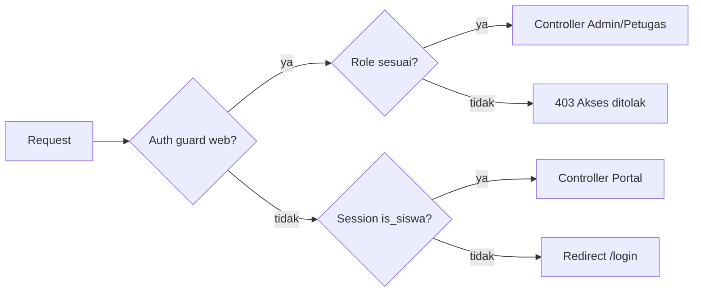

# 04 — Hak Akses Pengguna (Requirement #5)

Dokumen ini memetakan requirement **Hak Akses Pengguna** ke implementasi nyata pada aplikasi
`file skripsi` (Laravel 10, PHP 8.1, database `db_spp_smpm3`), mencatat celah yang ditemukan,
serta perubahan yang sudah diterapkan.

---

## 1. Ringkasan Eksekutif

| # | Requirement | Status awal | Status setelah perbaikan |
|---|-------------|-------------|--------------------------|
| 5.1 | Halaman login & autentikasi pengguna | ✅ Ada | ✅ Diperkuat (throttling, regenerasi sesi) |
| 5.2 | Siswa/orang tua dapat login | ✅ Ada (NIS + PIN Wali) | ✅ Diperkuat (PIN di-hash) |
| 5.3 | Melihat tagihan & riwayat pembayaran | ✅ Ada | ✅ Tetap |
| 5.4 | Melakukan pembayaran online | ⚠️ Ada, tetapi QRIS dapat "lunas" tanpa verifikasi | ✅ Diperbaiki (pending → verifikasi admin) |
| 5.5 | Admin mengelola pengguna, transaksi, tagihan, laporan | ✅ Ada | ✅ Tetap + tombol verifikasi transaksi |

Kesimpulan: **seluruh requirement sudah tersedia**, tetapi terdapat 12 temuan (5 di antaranya
diperbaiki pada iterasi ini) terkait keamanan dan integritas data. Perbaikan sudah diterapkan
pada kode (lihat §7).

---

## 2. Peta Requirement → Implementasi

### 5.1 Halaman login & autentikasi

| Komponen | Lokasi |
|----------|--------|
| Route login | `routes/web.php` → `GET /login`, `POST /login`, `POST /logout` |
| Controller | `app/Http/Controllers/AuthController.php` |
| View | `resources/views/auth/login.blade.php` |
| Tabel user | `users` (`name`, `email`, `password`, `role`) |
| Middleware | `auth` (Laravel), `role` (`CheckRole`), `siswa.session` (`CheckSiswaSession`) |

Alur petugas/admin:

```mermaid
flowchart TD
    A[GET /login] --> B{Tab Petugas}
    B --> C[Input email + password]
    C --> D{Cek RateLimiter<br/>maks 5 percobaan/menit}
    D -- diblokir --> E[Pesan: terlalu banyak percobaan]
    D -- lolos --> F[Auth::attempt]
    F -- gagal --> G[RateLimiter::hit + pesan error]
    F -- berhasil --> H[session()->regenerate]
    H --> I[Redirect /dashboard]
```

Alur siswa/orang tua:

```mermaid
flowchart TD
    A[GET /login?tab=siswa] --> B[Input NIS + PIN Wali]
    B --> C{RateLimiter}
    C -- diblokir --> D[Pesan: terlalu banyak percobaan]
    C -- lolos --> E[Cari siswa by NIS]
    E --> F{Status siswa aktif?}
    F -- tidak --> G[Pesan: status tidak aktif]
    F -- ya --> H{Verifikasi PIN<br/>Hash::check / legacy}
    H -- salah --> I[RateLimiter::hit + pesan error]
    H -- benar --> J[Rehash PIN lama bila masih plaintext]
    J --> K[session()->regenerate]
    K --> L[Set is_siswa, siswa_id, siswa_nama, ...]
    L --> M[Redirect /portal]
```

### 5.2 Login siswa/orang tua

- Kredensial: **NIS** + **PIN Wali** (`siswa.pin_wali`).
- Orang tua memakai akun yang sama dengan siswa — tidak ada akun terpisah, sehingga satu PIN
  mewakili keluarga. Ini memenuhi frasa "siswa atau orang tua".
- Siswa non-aktif (`status != aktif`) ditolak login.
- Sesi siswa disimpan terpisah dari guard `web`, dijaga middleware `siswa.session`, sehingga
  siswa tidak bisa membuka route admin dan sebaliknya.

### 5.3 Tagihan & riwayat pembayaran

| Fitur | Route | Controller | Data |
|-------|-------|-----------|------|
| Dashboard tagihan | `GET /portal` | `PortalSiswaController@dashboard` | status 12 bulan, total tunggakan, 5 riwayat terakhir |
| Riwayat lengkap | `GET /portal/riwayat` | `PortalSiswaController@riwayat` | paginasi SPP + non-budget |
| Kartu SPP | `GET /portal/kartu-spp` | `PortalSiswaController@kartuSpp` | kartu cetak per bulan |

Status tagihan dihitung dari `pembayaran_spp.status = 'berhasil'` per `bulan`, dibandingkan
dengan daftar 12 bulan tahun ajaran (`Juli`–`Juni`). Tunggakan = bulan berjalan ke belakang
yang belum lunas × tarif SPP tingkat kelas.

### 5.4 Pembayaran online

| Kanal | Route | Mekanisme | Verifikasi |
|-------|-------|-----------|------------|
| Midtrans Snap (VA/QRIS/e-wallet) | `POST /portal/bayar-online` | Buat transaksi `pending`, redirect ke Snap | Webhook `POST /midtrans/notification` dengan `signature_key` |
| QRIS DANA manual | `POST /portal/bayar-qris` | Tampilkan QR DANA, user klik konfirmasi | **Diperbaiki:** sekarang `pending`, diverifikasi admin |

Webhook Midtrans (`app/Http/Controllers/MidtransController.php`):

1. Membaca `order_id`, `status_code`, `gross_amount`, `signature_key`.
2. Memverifikasi signature `SHA512(order_id + status_code + gross_amount + server_key)`.
3. Memetakan status: `settlement`/`capture` → `berhasil`; `cancel`/`deny`/`expire` → `gagal`;
   `pending` → `pending`.
4. Meng-update baris `pembayaran_spp` berdasarkan `midtrans_order_id`.

### 5.5 Pengelolaan oleh admin

| Modul | Route | Controller | Role |
|-------|-------|-----------|------|
| Pengguna/petugas | `/master/users` (CRUD) | `MasterDataController` | admin |
| Transaksi SPP | `/pembayaran/spp` (index/create/store/show/delete) | `PembayaranSppController` | semua petugas login |
| Transaksi non-budget | `/pembayaran/nonbudget` | `NonBudgetController` | semua petugas login |
| Tagihan/tarif | `/master/tarif-spp`, `/master/tahun-ajaran` | `MasterDataController` | admin |
| Laporan keuangan | `/laporan/spp`, `/laporan/tunggakan`, `/laporan/nonbudget`, export CSV | `LaporanController` | semua petugas login |

---

## 3. Matriks Hak Akses

| Kemampuan | Admin | Bendahara | Kepala Sekolah | Siswa/Wali |
|-----------|:-----:|:---------:|:--------------:|:----------:|
| Login | ✅ | ✅ | ✅ | ✅ (NIS+PIN) |
| Dashboard admin | ✅ | ✅ | ✅ | ❌ |
| Data siswa (lihat) | ✅ | ✅ | ✅ | ❌ |
| Data siswa (tambah/ubah/hapus) | ✅ | ✅ | ⚠️ saat ini boleh | ❌ |
| Input pembayaran SPP | ✅ | ✅ | ⚠️ saat ini boleh | ❌ |
| Hapus transaksi | ✅ | ❌ | ❌ | ❌ |
| Laporan keuangan | ✅ | ✅ | ✅ | ❌ |
| Master data & pengguna | ✅ | ❌ | ❌ | ❌ |
| Portal tagihan | ❌ | ❌ | ❌ | ✅ |
| Bayar online | ❌ | ❌ | ❌ | ✅ |
| Ubah PIN | ❌ | ❌ | ❌ | ✅ |

**Catatan:** pembatasan menu di sidebar (`layouts/app.blade.php`) hanya menyembunyikan menu
admin. Route transaksi/siswa masih dapat diakses semua role yang login. Lihat temuan F-06.

---

## 4. Struktur Tabel yang Relevan

```
users
  id, name, email (unique), password (bcrypt), role enum(admin,bendahara,kepsek), timestamps

siswa
  id, nis (unique), nama, ..., pin_wali (string, sekarang bcrypt), kelas_id FK, tahun_ajaran_id FK,
  status enum(aktif,lulus,pindah,keluar), timestamps

pembayaran_spp
  id, siswa_id FK, tahun_ajaran_id FK, bulan, tahun, jumlah,
  metode_pembayaran enum(tunai,midtrans), status enum(pending,berhasil,gagal),
  midtrans_order_id, midtrans_transaction_id, catatan, petugas_id FK, timestamps
```

> **Catatan skema:** kode menggunakan nilai `qris` dan `midtrans-<payment_type>` pada
> `metode_pembayaran`, sedangkan migration hanya mengizinkan `tunai`/`midtrans`. Database live
> tampaknya sudah diubah manual. Lihat temuan F-08.

---

## 5. Alur Otorisasi



- `CheckRole::handle(..., ...$roles)` → `abort(403)` bila role tidak termasuk.
- `CheckSiswaSession::handle()` → redirect `login` bila `is_siswa`/`siswa_id` tidak ada.
- Route admin dibungkus `middleware('auth')`; route portal dibungkus `middleware('siswa.session')`.
- Master data dibungkus `middleware('role:admin')`.

---

## 6. Temuan Audit

| ID | Temuan | Tingkat | Dampak |
|----|--------|---------|--------|
| F-01 | `pin_wali` disimpan & dibandingkan plaintext | 🔴 Tinggi | PIN bocor bila DB/backup terbaca |
| F-02 | Tidak ada pembatasan percobaan login | 🔴 Tinggi | Brute force NIS + PIN 6 digit |
| F-03 | Sesi siswa tidak di-regenerate setelah login | 🟠 Sedang | Session fixation |
| F-04 | Kredensial demo tertulis di form login | 🟠 Sedang | Password admin bocor di HTML |
| F-05 | QRIS manual langsung `status = berhasil` | 🔴 Tinggi | Siswa bisa menandai lunas tanpa bayar |
| F-06 | Route siswa/tambah transaksi terbuka untuk semua role | 🟠 Sedang | Kepsek/bendahara bisa mengubah data di luar kewenangan |
| F-07 | PIN default `123`/`123456` + hint di UI | 🟠 Sedang | Akun mudah ditebak |
| F-08 | Enum `metode_pembayaran` tidak memuat `qris` | 🟠 Sedang | Error SQL pada MySQL strict / schema drift |
| F-09 | Verifikasi signature webhook dilewati bila server key kosong | 🟠 Sedang | Webhook palsu bisa diterima |
| F-10 | `GET /api/public/cek-siswa` membocorkan nama/kelas/status | 🟡 Rendah | Enumerasi NIS |
| F-11 | Belum ada reset PIN oleh admin / lupa PIN | 🟡 Rendah | Wali terkunci dari portal |
| F-12 | Logout siswa hanya `forget`, tidak invalidate sesi | 🟡 Rendah | Sesi lama tetap valid |

---

## 7. Perbaikan yang Diterapkan

### 7.0 Berkas yang Diubah

| Berkas | Perubahan |
|--------|-----------|
| `app/Http/Controllers/AuthController.php` | Rate limiting, regenerasi sesi, verifikasi PIN hash + migrasi otomatis, invalidasi sesi saat logout |
| `app/Http/Controllers/PortalSiswaController.php` | Hash PIN saat ubah, QRIS manual menjadi `pending`, validasi tarif & pembayaran ganda |
| `app/Http/Controllers/SiswaController.php` | Hash PIN pada tambah/ubah/impor siswa |
| `app/Http/Controllers/PembayaranSppController.php` | Method `verifikasi()` untuk transaksi pending |
| `routes/web.php` | Route `pembayaran.spp.verifikasi` (admin/bendahara) |
| `resources/views/auth/login.blade.php` | Hapus kredensial prefill, sembunyikan demo box di luar `local` |
| `resources/views/portal/dashboard.blade.php` | Teks QRIS menjadi "kirim konfirmasi / menunggu verifikasi" |
| `resources/views/pembayaran/spp/index.blade.php` | Badge status + tombol verifikasi, membersihkan markup ganda |

### F-01 — PIN di-hash (bcrypt) dengan fallback data lama

- `AuthController@login`: PIN lama yang masih plaintext tetap bisa login, lalu otomatis
  di-rehash (`Hash::make`) saat login berhasil.
- `PortalSiswaController@ubahPin`: verifikasi mendukung hash & plaintext, penyimpanan baru
  selalu hash.
- `SiswaController@store`, `@update`, `@importExcel`: PIN baru/impor di-hash.

### F-02 — Rate limiting login

- Maksimum **5 percobaan / 60 detik** per kombinasi `tipe|identitas|IP`.
- `RateLimiter::clear()` saat login berhasil.
- Pesan: "Terlalu banyak percobaan login. Silakan coba lagi dalam N detik."

### F-03 — Regenerasi sesi

- `$request->session()->regenerate()` dipanggil sebelum menulis sesi siswa.
- Logout siswa memakai `invalidate()` + `regenerateToken()`.

### F-04 — Hapus kredensial dari form

- `value` email/password/NIS/PIN default dihapus.
- Kotak akun demo hanya tampil saat `app()->environment('local')`.

### F-05 — QRIS manual menjadi `pending`

- `PortalSiswaController@bayarQris`: validasi tarif, cek bulan yang sudah lunas, simpan
  `status = pending`, catatan "Menunggu verifikasi admin".
- Ditambahkan `PembayaranSppController@verifikasi` + route
  `POST /pembayaran/spp/{pembayaranSpp}/verifikasi`.
- Tombol **Verifikasi** muncul pada daftar transaksi berstatus `pending` (role admin/bendahara).
- Pesan portal diubah menjadi "menunggu verifikasi admin", bukan "lunas".

### F-12 — Logout

- Sesi siswa di-invalidate penuh, bukan hanya menghapus beberapa key.

### F-06 (sebagian) — Hapus transaksi dibatasi di level route

- `DELETE /pembayaran/spp/{pembayaranSpp}` sekarang memakai middleware `role:admin`,
  sehingga konsisten dengan tombol yang hanya tampil untuk admin.

### 7.1 Hasil Uji Cepat (smoke test)

Pengujian dijalankan pada `php artisan serve` (PHP 8.1, MySQL lokal) setelah perubahan:

| Uji | Hasil |
|-----|-------|
| `GET /login` | 200; tidak ada lagi `value="admin123"` / `value="123456"` di HTML |
| Kotak akun demo | Hanya tampil karena `APP_ENV=local` |
| Login admin (`admin@sekolah.com` / `admin123`) | Redirect ke `/dashboard` |
| Login siswa (`202607001` / `123456`) | Redirect ke `/portal` |
| PIN lama plaintext setelah login | Otomatis berubah menjadi hash `$2y$...` |
| 6× login siswa dengan PIN salah | Percobaan ke-6 diblokir "Terlalu banyak percobaan login" |
| `POST /portal/bayar-qris` | 200, `status = pending`, pesan "menunggu verifikasi" |
| `POST /pembayaran/spp/{id}/verifikasi` (admin) | 200, status berubah menjadi `berhasil` |
| Data uji | Transaksi uji dihapus kembali dari database |

---

## 8. Rekomendasi Lanjutan (belum diterapkan)

1. **F-06**: kelompokkan route tulis dengan `role:admin,bendahara`; jadikan kepsek read-only.
2. **F-07**: wajibkan ganti PIN saat login pertama; hapus hint PIN default dari UI produksi.
3. **F-08**: buat migration yang mengubah `metode_pembayaran` menjadi `string` (bukan enum)
   atau menambah nilai `qris`; tambahkan kolom `tanggal_bayar` bila diperlukan.
4. **F-09**: tolak webhook bila server key kosong, jangan hanya melewati verifikasi.
5. **F-10**: hapus/rate-limit endpoint cek-siswa publik, atau minimal samarkan data.
6. **F-11**: tambah aksi admin "Reset PIN" (set ke PIN acak, paksa ganti saat login).
7. Tambahkan `password_confirmation` + kebijakan password kuat untuk akun petugas.
8. Aktifkan HTTPS + `SESSION_SECURE_COOKIE=true` di produksi.
9. Tambahkan audit log untuk aksi hapus transaksi & verifikasi pembayaran.

---

## 9. Checklist Pengujian Blackbox

| No | Skenario | Input | Hasil diharapkan |
|----|----------|-------|------------------|
| 1 | Login admin valid | email+password benar | Masuk dashboard |
| 2 | Login admin salah | password salah | Pesan error, tetap di login |
| 3 | Brute force | 6× password salah | Diblokir sementara |
| 4 | Login siswa valid | NIS + PIN benar | Masuk portal |
| 5 | Login siswa non-aktif | siswa status lulus | Ditolak |
| 6 | Akses portal tanpa login | buka `/portal` | Redirect login |
| 7 | Akses admin oleh siswa | buka `/dashboard` | Redirect/403 |
| 8 | Akses master oleh bendahara | buka `/master/users` | 403 |
| 9 | Lihat tagihan | buka portal | 12 bulan + tunggakan |
| 10 | Riwayat | buka `/portal/riwayat` | Daftar transaksi |
| 11 | Bayar Midtrans | pilih bulan | Snap terbuka, status pending |
| 12 | Webhook settlement | signature valid | Status berhasil |
| 13 | QRIS manual | klik konfirmasi | Status pending, bukan lunas |
| 14 | Verifikasi admin | klik Verifikasi | Status berhasil |
| 15 | Ubah PIN | PIN lama benar | PIN baru tersimpan (hash) |
| 16 | Ubah PIN | PIN lama salah | Ditolak |
| 17 | Logout | klik keluar | Sesi berakhir |

---

## 10. Kesimpulan

Requirement **Hak Akses Pengguna** sudah terpenuhi secara fungsional: tersedia login
petugas/admin dan login siswa/wali, pembatasan akses berbasis role/sesi, portal tagihan &
riwayat, pembayaran online melalui Midtrans, serta pengelolaan pengguna/transaksi/tagihan/laporan
oleh admin. Perbaikan yang diterapkan menutup celah paling berisiko—PIN plaintext, brute force,
session fixation, kredensial demo di HTML, dan konfirmasi QRIS palsu—sehingga implementasi lebih
layak dipakai dan dipertanggungjawabkan dalam sidang.
