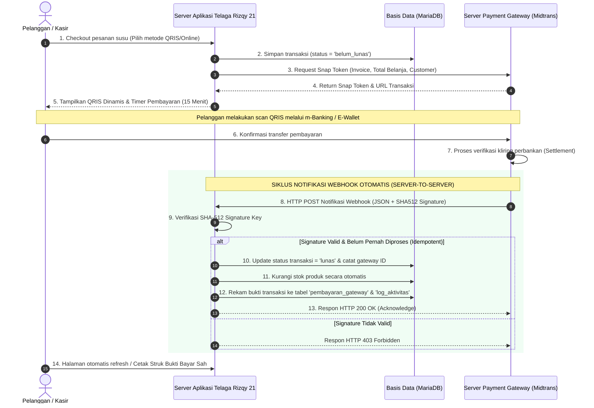

# DOKUMENTASI SISTEM PEMBAYARAN ONLINE (PAYMENT GATEWAY & WEBHOOK)
**Sistem Informasi Pengolahan Data Transaksi Keuangan Berbasis Web**  
**Studi Kasus:** Telaga Rizqy 21 (Peternakan & Pengolahan Susu Kambing)

---

## 1. Latar Belakang & Tujuan Integrasi

Pada sistem rujukan sebelumnya (skripsi kating), transaksi kasir hanya mendukung pembayaran manual secara tunai (*cash*), di mana kasir menghitung pembayaran dan kembalian menggunakan kalkulator, serta mencatat secara manual di buku penjualan. 

Perbaikan sistem ini mengintegrasikan **Payment Gateway Online** (Midtrans Snap & Core API) untuk:
1. **Mendukung Pembayaran Non-Tunai:** QRIS Dinamis (GoPay, ShopeePay, Dana, LinkAja, BCA Mobile) dan Virtual Account Bank Nasional (BCA, BNI, BRI, Mandiri).
2. **Otomasi Pembaruan Status Transaksi:** Mengeliminasi kebutuhan konfirmasi manual dari pembeli melalui mekanisme **Webhook (HTTP Notification Callback)**.
3. **Sinkronisasi Stok Fisik Secara Otomatis:** Saat transaksi terkonfirmasi lunas oleh sistem perbankan, stok susu di tabel `produk` berkurang seketika.
4. **Keamanan Finansial Terverifikasi:** Menggunakan validasi kriptografi tanda tangan digital `SHA-512 Signature Key`.

---

## 2. Diagram Alur Transaksi & Webhook (Sequence Diagram)

Berikut alur komunikasi data antara Pelanggan/Kasir, Server Aplikasi Telaga Rizqy 21, dan Server Payment Gateway:



---

## 3. Siklus Status Pembayaran

Setiap transaksi memiliki status pembayaran yang dikontrol secara konsisten pada kolom `transaksi.status_pembayaran`:

| Status di Database | Status Gateway (Midtrans) | Kondisi & Makna Bisnis | Aksi Otomatis Sistem |
|---|---|---|---|
| `belum_lunas` | `pending` | Token QRIS/VA telah diterbitkan, menunggu pembeli melakukan transfer dana. | Menampilkan QRIS dinamis dan hitung mundur masa berlaku. |
| `lunas` | `settlement` | Pembayaran berhasil diverifikasi secara penuh oleh bank/e-wallet. | • Status diubah ke `lunas`<br>• Nominal `total_bayar` tercatat<br>• Stok produk otomatis dikurangi<br>• Mencatat ke tabel riwayat log audit. |
| `lunas` | `capture` (*fraud: accept*) | Transaksi kartu kredit/debit disetujui tanpa risiko penipuan (*fraud pass*). | Sama seperti status `settlement`. |
| `batal` | `expire` | Pembeli tidak menyelesaikan pembayaran hingga batas waktu (cth: 15-60 menit habis). | Transaksi dinyatakan kadaluarsa, pesanan dibatalkan, dan kuota stok tidak terpotong. |
| `batal` | `cancel` / `deny` | Pembayaran ditolak oleh bank penerbit atau dibatalkan oleh kasir/admin. | Transaksi ditandai batal. |

---

## 4. Standar & Protokol Keamanan Pembayaran

Untuk memastikan sistem tahan terhadap manipulasi data dan serangan siber, diterapkan 5 lapisan proteksi:

### A. Validasi Tanda Tangan Kriptografi (SHA-512 Signature Key)
Setiap notifikasi webhook yang masuk wajib diverifikasi menggunakan formula resmi:
$$\text{Signature} = \text{SHA512}(\text{order\_id} + \text{status\_code} + \text{gross\_amount} + \text{ServerKey})$$
Aplikasi menghitung ulang hash tersebut menggunakan kunci rahasia (*Server Key*) yang hanya diketahui oleh server dan gateway. Jika signature tidak cocok, permintaan ditolak dengan kode respon `HTTP 403 Forbidden`.

### B. Penanganan Idempotency (Anti Pemrosesan Ganda)
Server Payment Gateway dapat mengirimkan notifikasi ulang jika terjadi kendala jaringan (*retry policy*). Sistem memeriksa apakah status transaksi pada database sudah berstatus `lunas`. Jika sudah, webhook berikutnya langsung dibalas `HTTP 200 OK` tanpa melakukan pengurangan stok atau manipulasi saldo berulang.

### C. Isolasi Database Transaction (ACID)
Proses update status transaksi, pemotongan stok barang, dan pencatatan riwayat audit dibungkus dalam blok `BEGIN TRANSACTION` dan `COMMIT` PDO. Jika terjadi galat di salah satu query, seluruh perubahan dibatalkan (`ROLLBACK`) untuk mencegah inkonsistensi data.

### D. Enkripsi Kredensial Lingkungan
Kunci rahasia API (*Server Key* dan *Client Key*) dipisahkan dari source code utama menggunakan file konfigurasi lingkungan atau variabel environment (`getenv`), mencegah kebocoran kredensial di repositori publik.

---

## 5. Kamus Data Tabel Tambahan Pembayaran Online

Telah disediakan file migrasi [migration_pembayaran_online.sql](file:///c:/Users/advan/Documents/Skripsi%20kating/migration_pembayaran_online.sql) yang menambahkan tabel audit:

```sql
CREATE TABLE `pembayaran_gateway` (
  `id_gateway_log` INT(11) NOT NULL AUTO_INCREMENT,
  `id_transaksi` INT(11) NOT NULL,
  `order_id` VARCHAR(100) NOT NULL,
  `transaction_id` VARCHAR(100) DEFAULT NULL,
  `payment_type` VARCHAR(50) NOT NULL, -- qris, gopay, bank_transfer, dll.
  `gross_amount` DECIMAL(12,2) NOT NULL,
  `currency` VARCHAR(10) NOT NULL DEFAULT 'IDR',
  `transaction_status` ENUM('pending', 'settlement', 'capture', 'deny', 'cancel', 'expire', 'refund') NOT NULL,
  `fraud_status` VARCHAR(20) DEFAULT NULL,
  `status_code` VARCHAR(10) NOT NULL,
  `signature_key` VARCHAR(255) DEFAULT NULL,
  `raw_notification` LONGTEXT NOT NULL,
  `waktu_notifikasi` DATETIME NOT NULL DEFAULT CURRENT_TIMESTAMP,
  PRIMARY KEY (`id_gateway_log`),
  KEY `fk_gw_transaksi` (`id_transaksi`),
  CONSTRAINT `fk_gw_transaksi` FOREIGN KEY (`id_transaksi`) REFERENCES `transaksi` (`id_transaksi`) ON DELETE CASCADE
) ENGINE=InnoDB DEFAULT CHARSET=utf8mb4 COLLATE=utf8mb4_unicode_ci;
```

---

## 6. Contoh Format Data Notifikasi Webhook (Payload JSON)

Contoh payload resmi yang dikirimkan gateway ke endpoint `webhook_midtrans.php`:

```json
{
  "va_numbers": [],
  "transaction_time": "2026-11-12 21:14:02",
  "transaction_status": "settlement",
  "transaction_id": "89b78a22-3490-41fa-8cb1-897fa0812341",
  "status_message": "midtrans payment notification",
  "status_code": "200",
  "signature_key": "d74a4cf96594d23bb80219412... (SHA-512 Hash)",
  "settlement_time": "2026-11-12 21:14:15",
  "payment_type": "qris",
  "order_id": "INV/2026/11/TR-0089",
  "merchant_id": "G123456789",
  "gross_amount": "96000.00",
  "fraud_status": "accept",
  "currency": "IDR",
  "acquirer": "gopay"
}
```

---

## 7. Panduan Implementasi pada Framework CodeIgniter 3

Sesuai batasan masalah pada Bab I rujukan tugas akhir, jika menggunakan CodeIgniter 3:

1. **Letakkan Service:** Salin [MidtransService.php](file:///c:/Users/advan/Documents/Skripsi%20kating/MidtransService.php) ke dalam folder `application/libraries/MidtransService.php`.
2. **Controller Webhook:** Buat Controller baru `application/controllers/Webhook.php`:
   ```php
   class Webhook extends CI_Controller {
       public function midtrans() {
           require_once APPPATH . 'libraries/MidtransService.php';
           // Muat model dan jalankan logika verifikasi signature seperti pada webhook_midtrans.php
       }
   }
   ```
3. **Pengecualian CSRF:** Buka `application/config/config.php`, tambahkan route webhook pada pengecualian proteksi CSRF:
   ```php
   $config['csrf_exclude_uris'] = array('webhook/midtrans', 'api/webhook.*');
   ```
   *(Hal ini wajib dilakukan karena notifikasi dikirimkan dari server Midtrans tanpa membawa session cookie browser).*

