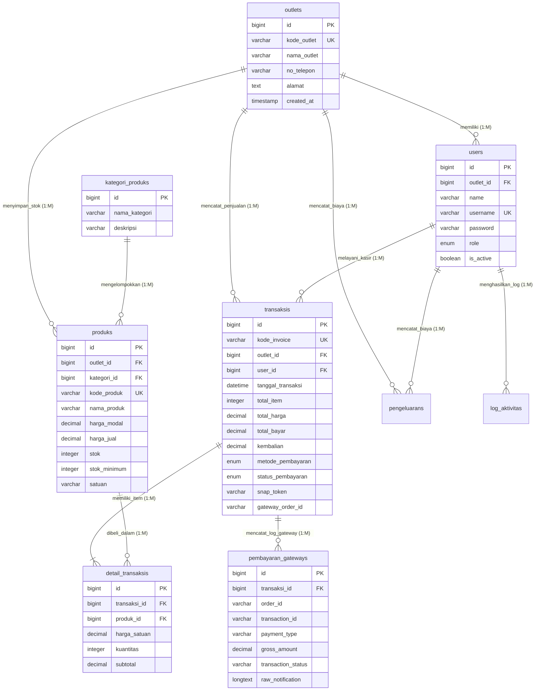

# LAPORAN LENGKAP HASIL PERANCANGAN SISTEM
**Sistem Informasi Pengolahan Data Transaksi Keuangan Berbasis Web dengan Integrasi Payment Gateway Online**  
**Studi Kasus:** Telaga Rizqy 21 (Peternakan & Pengolahan Susu Kambing, Metro)

---

## 1. Analisis Kebutuhan Sistem

### 1.1 Identifikasi Masalah Sistem Lama (As-Is)
Berdasarkan hasil observasi dan dokumen rujukan tugas akhir, sistem berjalan pada Telaga Rizqy 21 menghadapi kendala sebagai berikut:
1. **Pencatatan Penjualan Manual:** Masih menggunakan buku tulis kasir dan kalkulator konvensional, sehingga rawan kesalahan hitung (*human error*) serta tulisan sulit terbaca.
2. **Ketiadaan Kontrol Stok Fisik:** Kasir tidak memiliki informasi ketersediaan stok produk susu yang menipis secara *real-time*.
3. **Keterbatasan Metode Pembayaran:** Hanya mengandalkan uang tunai (*cash*), sering terkendala uang kembalian pecahan kecil, serta belum mendukung ekosistem digital non-tunai (QRIS & Transfer Bank).
4. **Penyusunan Laporan Lambat:** Rekapitulasi omzet penjualan dan pembukuan laba rugi di akhir bulan memakan waktu berhari-hari karena pencarian nota manual yang berserakan.

### 1.2 Kebutuhan Fungsional (*Functional Requirements*)
Sistem baru yang dibangun harus mampu menjalankan fungsi-fungsi utama berikut:
* **Modul Autentikasi & Otorisasi:**
  * Login akun staf dengan pemisahan hak akses berbasis peran (*Role-Based Access Control* / RBAC): Administrator dan Kasir.
* **Modul Master Data:**
  * Kelola data unit usaha / outlet.
  * Kelola kategori produk susu (Susu Bubuk, Susu Segar/Pasteurisasi, Susu Kotak).
  * Kelola katalog produk (SKU/Kode, Nama, Harga Pokok/Modal, Harga Jual, Stok Fisik, Satuan).
* **Modul Point of Sales (POS) & Transaksi Kasir:**
  * Kasir dapat memilih produk, menentukan kuantitas, dan menghitung subtotal otomatis.
  * Mendukung dua metode pembayaran: **Tunai (Cash)** dengan hitung kembalian instan, dan **Online (Payment Gateway / QRIS)**.
  * Pembuatan nomor invoice penjualan unik secara otomatis (`INV/YYYY/MM/TR-XXXX`).
* **Modul Payment Gateway & Webhook:**
  * Pembuatan token transaksi dan *dynamic QRIS* melalui Midtrans Snap API.
  * Penerimaan notifikasi otomatis (*webhook callback*) dari gateway tanpa intervensi kasir.
  * Pengurangan stok produk susu secara otomatis seketika pembayaran dinyatakan lunas.
  * Penguncian harga historis (*price snapshot*) pada setiap baris item belanja.
* **Modul Kas Operasional & Pengeluaran:**
  * Pencatatan beban pengeluaran harian peternakan (pakan kambing, kemasan, operasional, listrik).
* **Modul Pelaporan Keuangan & Cetak Struk:**
  * Cetak struk belanja thermal / nota digital untuk konsumen.
  * Laporan rekapitulasi penjualan harian, bulanan, dan rentang tanggal tertentu.
  * Laporan arus kas (*Cash Flow*) dan estimasi laba bersih (Total Penjualan - HPP - Pengeluaran).
* **Modul Audit Trail (Log Aktivitas):**
  * Pencatatan riwayat setiap aksi login, transaksi, dan perubahan data penting.

### 1.3 Kebutuhan Non-Fungsional (*Non-Functional Requirements*)
* **Keamanan (*Security*):**
  * Hash password menggunakan algoritma Bcrypt / Argon2.
  * Proteksi Webhook menggunakan verifikasi tanda tangan digital `SHA-512 Signature Key`.
  * Penanganan *Idempotency* untuk mencegah pemotongan stok ganda akibat retry webhook.
  * Perlindungan CSRF pada seluruh form aplikasi web, dengan pengecualian khusus untuk rute webhook gateway.
* **Keandalan & Integritas Data (*Reliability & ACID*):**
  * Transaksi database menggunakan engine InnoDB dengan foreign key constraints dan cascading rule yang aman.
* **Performa & Kompatibilitas (*Performance & Usability*):**
  * Antarmuka web responsif (dapat diakses nyaman melalui PC kasir, laptop, maupun tablet/smartphone).
  * Response time pemrosesan transaksi kasir di bawah 2 detik.

### 1.4 Aktor & Matriks Hak Akses

| No | Fitur / Hak Akses | Administrator | Kasir |
|---|---|:---:|:---:|
| 1 | Login & Logout Sistem | ✓ | ✓ |
| 2 | Dashboard Ringkasan & Grafik Omzet | ✓ | ✓ (Terbatas) |
| 3 | Kelola Master Data Outlet, Kategori & Produk | ✓ | Hanya Lihat |
| 4 | Kelola Data Akun Pengguna / Staf | ✓ | ✗ |
| 5 | Transaksi Kasir (POS) Tunai & Online QRIS | ✓ | ✓ |
| 6 | Cetak Ulang Struk & Bukti Bayar | ✓ | ✓ |
| 7 | Catat Pengeluaran Operasional Peternakan | ✓ | ✓ |
| 8 | Cetak Laporan Keuangan & Laba Bersih | ✓ | Hanya Rekap Kasir |
| 9 | Lihat Log Aktivitas Sistem (Audit Trail) | ✓ | ✗ |

---

## 2. Rancangan Database & Pembuktian Normalisasi

Perancangan basis data baru telah melewati proses normalisasi dari Unnormalized Form (UNF) hingga Third Normal Form (3NF) guna menjamin tidak adanya redundansi data, anomali sisip (*insert anomaly*), anomali hapus (*delete anomaly*), maupun anomali ubah (*update anomaly*).

### 2.1 Unnormalized Form (UNF)
Pada bentuk tidak ternormalisasi (dokumen lama kating), seluruh data faktur dicampuradukkan:
```
UNF = { no_invoice, tanggal, nama_outlet, nama_kasir, nama_produk, harga_produk, qty, total_faktur, total_bayar, kembalian, status_bayar, kategori_pengeluaran, biaya }
```
*Kelemahan:* Muncul perulangan grup data (*repeating group*) pada produk yang dibeli dalam satu faktur.

### 2.2 First Normal Form (1NF)
Menghilangkan repeating group sehingga setiap atribut bernilai atomik (*atomic value*), dan mendefinisikan Primary Key sementara.
```
1NF = { 
  no_invoice (PK), id_produk (PK), tanggal, id_outlet, nama_outlet, 
  id_user, nama_user, peran, nama_produk, harga_modal, harga_jual, 
  stok, satuan, qty, subtotal, total_faktur, total_bayar, status_bayar
}
```
*Kelemahan 1NF:* Terdapat **Ketergantungan Parsial (Partial Functional Dependency)**, di mana nama produk dan harga jual hanya bergantung pada `id_produk`, bukan pada composite key (`no_invoice, id_produk`).

### 2.3 Second Normal Form (2NF)
Menghilangkan ketergantungan parsial dengan memecah relasi menjadi entitas mandiri berdasarkan functional dependency penuh:
* Relasi Outlet: `id_outlet` $\rightarrow$ `nama_outlet, no_telepon, alamat`
* Relasi Pengguna: `id_user` $\rightarrow$ `id_outlet, nama_lengkap, username, password, peran`
* Relasi Produk: `id_produk` $\rightarrow$ `id_outlet, id_kategori, kode_produk, nama_produk, harga_modal, harga_jual, stok, satuan`
* Relasi Transaksi (Header): `id_transaksi` $\rightarrow$ `kode_invoice, id_outlet, id_user, tanggal_transaksi, total_item, total_harga, total_bayar, status_pembayaran`
* Relasi Detail Transaksi: `id_detail` $\rightarrow$ `id_transaksi, id_produk, harga_satuan, kuantitas, subtotal`

### 2.4 Third Normal Form (3NF)
Menghilangkan **Ketergantungan Transitif (Transitive Dependency)**, di mana atribut non-key tidak boleh bergantung pada atribut non-key lainnya:
* Atribut kategori produk dipisahkan menjadi tabel mandiri `kategori_produk` (`id_kategori` $\rightarrow$ `nama_kategori, deskripsi`).
* Pemisahan tabel beban operasional ke dalam `pengeluaran`.
* Pencatatan audit trail ke dalam `log_aktivitas`.
* Hasil pembagian ini menghasilkan 9 tabel murni yang memenuhi kaidah **3NF**.

---

## 3. Kamus Data & Relasi Antar Tabel

1. **`outlets`**: Data cabang fisik usaha peternakan.
2. **`users`**: Data otentikasi admin dan kasir.
3. **`kategori_produks`**: Pengelompokan susu bubuk, susu pasteurisasi, susu kemasan.
4. **`produks`**: Data inventori barang, harga modal, harga jual, stok minimum, dan satuan.
5. **`transaksis`**: Header faktur penjualan, status pembayaran, token snap gateway, dan metadata pelunasan.
6. **`detail_transaksis`**: Item detail penjualan yang mencatat harga satuan riil (*price snapshot*) saat transaksi.
7. **`pengeluarans`**: Buku kas keluar operasional peternakan.
8. **`pembayaran_gateways`**: Log audit respon webhook dari Midtrans.
9. **`log_aktivitas`**: Audit trail aktivitas sistem.

---

## 4. Visualisasi Diagram ERD



