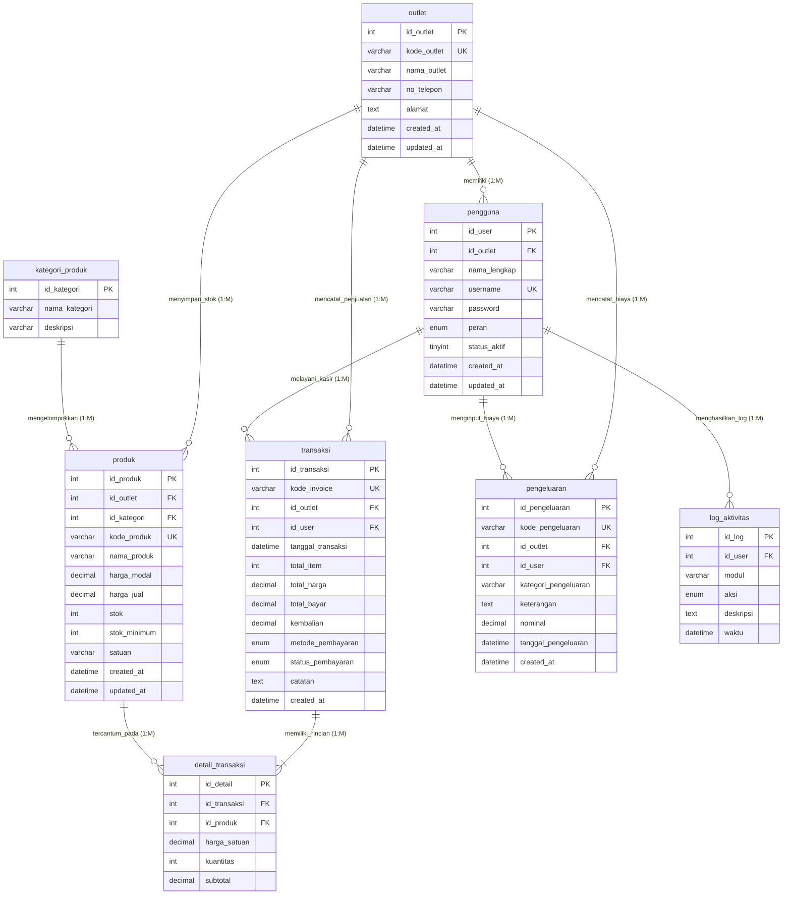

# DOKUMEN PERANCANGAN ERD BARU (DATABASE HASIL PERBAIKAN)
**Sistem Informasi Pengolahan Data Transaksi Keuangan Berbasis Web**  
**Studi Kasus:** Telaga Rizqy 21 (Peternakan & Pengolahan Susu Kambing)

---

## 1. Analisis Evaluasi Database Lama vs Solusi Perbaikan Baru

Berdasarkan analisis terhadap dokumen Tugas Akhir sebelumnya (`telagarizqy21`), ditemukan beberapa kelemahan struktural yang telah diperbaiki pada perancangan database baru ini:

| No | Komponen / Aspek | Skema Lama (Referensi Kating) | Kelemahan Skema Lama | Solusi Perbaikan (Skema Baru) |
|---|---|---|---|---|
| 1 | **Struktur Transaksi Penjualan** | Memisahkan `tb_transaksi` dan `tb_pembayaran` tanpa relasi master-detail yang jelas (hanya ditautkan via string `kode_invoice`). | `tb_transaksi` menyimpan `id_menu` dan `kuantitas`, namun di dalamnya terdapat atribut status bayar dan tanggal transaksi yang terduplikasi di setiap baris item produk. | Diterapkan pola **Master-Detail Transaksi**:  • `transaksi` sebagai tabel Master (Header Invoice) • `detail_transaksi` sebagai tabel Detail (Line Items). |
| 2 | **Integritas Nilai Historis (*Price Snapshot*)** | `tb_transaksi` tidak mencatat `harga_satuan` saat transaksi berlangsung (hanya merujuk pada `tb_menu.harga_menu`). | Jika di masa depan harga susu di master menu berubah/naik, perhitungan ulang riwayat transaksi masa lalu akan menghasilkan nilai yang salah (*historical data corruption*). | Kolom `harga_satuan` dan `subtotal` disimpan permanen di tabel `detail_transaksi`. |
| 3 | **Manajemen Stok Produk** | Tabel `tb_menu` hanya menyimpan `nama_menu` dan `harga_menu`, tidak ada atribut kuantitas stok. | Kontradiktif dengan latar belakang masalah (Hal. 2) yang menyebutkan kasir sering tidak mengetahui jika stok susu hampir habis. | Menambahkan kolom `stok`, `stok_minimum`, `satuan` (botol/kotak/pack), dan `kategori` pada tabel produk untuk mendukung peringatan dini (*stock warning*). |
| 4 | **Tipe Data Waktu & Keuangan** | Atribut tanggal menggunakan `int(11)`, dan nominal uang menggunakan integer standar. | Format waktu Unix timestamp menyulitkan query laporan langsung di SQL, dan integer rawan keterbatasan presisi. | Menggunakan tipe data `DATETIME` / `TIMESTAMP` standar dengan `CURRENT_TIMESTAMP`, serta `DECIMAL(12, 2)` untuk nilai moneter yang akurat. |
| 5 | **Redundansi Audit Log** | Terdapat dua tabel log terpisah: `tb_log` dan `tb_log_pengeluaran`. | Duplikasi fungsi dan pemborosan struktur tabel audit. | Digabungkan menjadi satu tabel audit terpadu `log_aktivitas` dengan kolom `modul` dan `aksi` yang dapat mencakup seluruh kegiatan sistem. |
| 6 | **Konsistensi Penamaan** | Nama atribut tidak seragam (`jml_uang_dibayar`, `tgl_transaksi`, `tanggal_pengeluaran`, `keterangan_pengeluaran`). | Sulit dipelihara dan rawan kesalahan penulisan kode program (*typo*). | Diterapkan standar **snake_case** yang baku dan konsisten di seluruh tabel dan kolom. |

---

## 2. Kamus Data & Spesifikasi Tabel Baru

### A. Tabel `outlet`
Menyimpan data unit usaha/cabang peternakan dan penjualan.
* **Primary Key:** `id_outlet`
* **Foreign Key:** -

| Nama Kolom | Tipe Data | Nullable | Keterangan |
|---|---|---|---|
| `id_outlet` | INT (11) AUTO_INCREMENT | NO | **PK**, Identifier unik outlet |
| `kode_outlet` | VARCHAR(20) | NO | Kode unik outlet (cth: `OTL-01`) |
| `nama_outlet` | VARCHAR(100) | NO | Nama cabang / tempat usaha |
| `no_telepon` | VARCHAR(20) | YES | Nomor telepon operasional |
| `alamat` | TEXT | YES | Alamat lengkap lokasi peternakan/toko |
| `created_at` | DATETIME | NO | Waktu pembuatan data |
| `updated_at` | DATETIME | YES | Waktu pembaruan data terakhir |

---

### B. Tabel `pengguna`
Menyimpan kredensial dan hak akses staf (Admin & Kasir).
* **Primary Key:** `id_user`
* **Foreign Key:** `id_outlet` $\rightarrow$ `outlet(id_outlet)`

| Nama Kolom | Tipe Data | Nullable | Keterangan |
|---|---|---|---|
| `id_user` | INT (11) AUTO_INCREMENT | NO | **PK**, Identifier unik pengguna |
| `id_outlet` | INT (11) | NO | **FK**, Outlet tempat pengguna bertugas |
| `nama_lengkap` | VARCHAR(100) | NO | Nama asli staf/kasir/admin |
| `username` | VARCHAR(50) | NO | Username untuk autentikasi login (UNIQUE) |
| `password` | VARCHAR(255) | NO | Hash password (disarankan bcrypt) |
| `peran` | ENUM('admin', 'kasir') | NO | Hak akses pengguna di sistem |
| `status_aktif` | TINYINT(1) | NO | Status akun (1: Aktif, 0: Nonaktif) |
| `created_at` | DATETIME | NO | Waktu akun didaftarkan |
| `updated_at` | DATETIME | YES | Waktu perubahan akun |

---

### C. Tabel `kategori_produk`
Mengelompokkan jenis produk susu olahan Telaga Rizqy 21.
* **Primary Key:** `id_kategori`
* **Foreign Key:** -

| Nama Kolom | Tipe Data | Nullable | Keterangan |
|---|---|---|---|
| `id_kategori` | INT (11) AUTO_INCREMENT | NO | **PK**, Identifier kategori |
| `nama_kategori` | VARCHAR(50) | NO | Nama kategori (Susu Bubuk, Susu Segar, dll) |
| `deskripsi` | VARCHAR(255) | YES | Catatan singkat kategori |

---

### D. Tabel `produk`
Menyimpan katalog produk susu dan status persediaan barang.
* **Primary Key:** `id_produk`
* **Foreign Key:** `id_outlet` $\rightarrow$ `outlet(id_outlet)`, `id_kategori` $\rightarrow$ `kategori_produk(id_kategori)`

| Nama Kolom | Tipe Data | Nullable | Keterangan |
|---|---|---|---|
| `id_produk` | INT (11) AUTO_INCREMENT | NO | **PK**, Identifier produk |
| `id_outlet` | INT (11) | NO | **FK**, Outlet pemilik stok produk |
| `id_kategori` | INT (11) | NO | **FK**, Kategori produk |
| `kode_produk` | VARCHAR(30) | NO | Barcode/SKU unik (cth: `PRD-RZQ-01`) |
| `nama_produk` | VARCHAR(100) | NO | Nama produk susu (cth: Susu Rizqiku Jahe) |
| `harga_modal` | DECIMAL(12, 2) | NO | Harga pokok produksi / modal (HPP) |
| `harga_jual` | DECIMAL(12, 2) | NO | Harga jual ke konsumen |
| `stok` | INT (11) | NO | Jumlah stok fisik yang tersedia |
| `stok_minimum` | INT (11) | NO | Batas ambang peringatan stok menipis (default: 5) |
| `satuan` | VARCHAR(20) | NO | Satuan unit barang (kotak, botol, sachet, liter) |
| `created_at` | DATETIME | NO | Waktu input produk |
| `updated_at` | DATETIME | YES | Waktu update informasi produk |

---

### E. Tabel `transaksi`
Menyimpan rekap utama faktur penjualan (Header Transaksi).
* **Primary Key:** `id_transaksi`
* **Foreign Key:** `id_outlet` $\rightarrow$ `outlet(id_outlet)`, `id_user` $\rightarrow$ `pengguna(id_user)`

| Nama Kolom | Tipe Data | Nullable | Keterangan |
|---|---|---|---|
| `id_transaksi` | INT (11) AUTO_INCREMENT | NO | **PK**, Identifier unik transaksi |
| `kode_invoice` | VARCHAR(50) | NO | Nomor nota penjualan unik (cth: `INV/2026/11/0001`) |
| `id_outlet` | INT (11) | NO | **FK**, Outlet terjadinya transaksi |
| `id_user` | INT (11) | NO | **FK**, Kasir yang melayani transaksi |
| `tanggal_transaksi` | DATETIME | NO | Waktu dan tanggal transaksi dicatat |
| `total_item` | INT (11) | NO | Akumulasi total kuantitas barang |
| `total_harga` | DECIMAL(12, 2) | NO | Total tagihan kotor sebelum potongan |
| `total_bayar` | DECIMAL(12, 2) | NO | Nominal uang yang diterima kasir |
| `kembalian` | DECIMAL(12, 2) | NO | Selisih uang kembalian untuk konsumen |
| `metode_pembayaran`| ENUM('tunai', 'transfer', 'qris') | NO | Metode bayar yang digunakan |
| `status_pembayaran`| ENUM('lunas', 'belum_lunas', 'batal') | NO | Status penyelesaian pembayaran |
| `catatan` | TEXT | YES | Catatan khusus pesanan |
| `created_at` | DATETIME | NO | Waktu rekaman invoice dibuat |

---

### F. Tabel `detail_transaksi`
Menyimpan rincian item barang yang dibeli per invoice.
* **Primary Key:** `id_detail`
* **Foreign Key:** `id_transaksi` $\rightarrow$ `transaksi(id_transaksi)` [CASCADE], `id_produk` $\rightarrow$ `produk(id_produk)`

| Nama Kolom | Tipe Data | Nullable | Keterangan |
|---|---|---|---|
| `id_detail` | INT (11) AUTO_INCREMENT | NO | **PK**, Identifier rincian item |
| `id_transaksi` | INT (11) | NO | **FK**, Rujukan ke invoice induk |
| `id_produk` | INT (11) | NO | **FK**, Rujukan ke produk yang dibeli |
| `harga_satuan` | DECIMAL(12, 2) | NO | *Price snapshot* harga barang saat transaksi |
| `kuantitas` | INT (11) | NO | Jumlah unit barang yang dibeli |
| `subtotal` | DECIMAL(12, 2) | NO | Hasil kali `harga_satuan * kuantitas` |

---

### G. Tabel `pengeluaran`
Mencatat seluruh beban pengeluaran operasional usaha.
* **Primary Key:** `id_pengeluaran`
* **Foreign Key:** `id_outlet` $\rightarrow$ `outlet(id_outlet)`, `id_user` $\rightarrow$ `pengguna(id_user)`

| Nama Kolom | Tipe Data | Nullable | Keterangan |
|---|---|---|---|
| `id_pengeluaran` | INT (11) AUTO_INCREMENT | NO | **PK**, Identifier pengeluaran |
| `kode_pengeluaran` | VARCHAR(50) | NO | Nomor bukti kas keluar (cth: `BKK/2026/11/001`) |
| `id_outlet` | INT (11) | NO | **FK**, Outlet yang mengeluarkan biaya |
| `id_user` | INT (11) | NO | **FK**, Penanggung jawab pencatat |
| `kategori_pengeluaran`| VARCHAR(50) | NO | Kategori biaya (Pakan Kambing, Listrik, Kemasan, Gaji) |
| `keterangan` | TEXT | NO | Rincian keperluan pengeluaran |
| `nominal` | DECIMAL(12, 2) | NO | Besaran biaya yang dikeluarkan |
| `tanggal_pengeluaran`| DATETIME | NO | Tanggal pengeluaran kas terjadi |
| `created_at` | DATETIME | NO | Waktu input data |

---

### H. Tabel `log_aktivitas`
Mencatat rekam jejak aktivitas operasional pengguna (Audit Trail).
* **Primary Key:** `id_log`
* **Foreign Key:** `id_user` $\rightarrow$ `pengguna(id_user)`

| Nama Kolom | Tipe Data | Nullable | Keterangan |
|---|---|---|---|
| `id_log` | INT (11) AUTO_INCREMENT | NO | **PK**, Identifier log |
| `id_user` | INT (11) | NO | **FK**, Pengguna yang melakukan aksi |
| `modul` | VARCHAR(50) | NO | Modul sistem (cth: `TRANSAKSI`, `PRODUK`, `PENGELUARAN`) |
| `aksi` | ENUM('login', 'logout', 'tambah', 'ubah', 'hapus', 'cetak') | NO | Jenis aktivitas yang dilakukan |
| `deskripsi` | TEXT | NO | Rincian aksi (cth: *Kasir mencetak invoice INV/2026/11/0001*) |
| `waktu` | DATETIME | NO | Waktu aktivitas tercatat |

---

## 3. Matriks Kardinalitas Relasi Antar Tabel

| Relasi Tabel | Jenis Kardinalitas | Penjelasan Bisnis (*Business Rule*) |
|---|---|---|
| `outlet` $\rightarrow$ `pengguna` | **One-to-Many (1 : M)** | Satu outlet menaungi satu atau banyak akun pengguna (Admin/Kasir), sedangkan setiap pengguna ditugaskan pada tepat satu outlet. |
| `outlet` $\rightarrow$ `produk` | **One-to-Many (1 : M)** | Satu outlet mengelola banyak katalog produk/stok, dan tiap data stok produk terikat pada outlet bersangkutan. |
| `outlet` $\rightarrow$ `transaksi` | **One-to-Many (1 : M)** | Satu outlet mencatat banyak transaksi penjualan. |
| `outlet` $\rightarrow$ `pengeluaran` | **One-to-Many (1 : M)** | Satu outlet mencatat banyak transaksi pengeluaran operasional. |
| `kategori_produk` $\rightarrow$ `produk` | **One-to-Many (1 : M)** | Satu kategori produk menaungi banyak produk susu, sedangkan satu produk hanya memiliki satu kategori utama. |
| `pengguna` $\rightarrow$ `transaksi` | **One-to-Many (1 : M)** | Seorang kasir/admin dapat melayani banyak transaksi penjualan, namun tiap transaksi dicatat oleh satu kasir penanggung jawab. |
| `pengguna` $\rightarrow$ `pengeluaran` | **One-to-Many (1 : M)** | Seorang pengguna dapat mencatat banyak entri pengeluaran kas. |
| `pengguna` $\rightarrow$ `log_aktivitas` | **One-to-Many (1 : M)** | Setiap aktivitas pengguna dicatat ke dalam satu atau banyak riwayat log. |
| `transaksi` $\rightarrow$ `detail_transaksi` | **One-to-Many (1 : M)** | Satu invoice transaksi memiliki satu atau banyak rincian barang belanjaan (*line items*). |
| `produk` $\rightarrow$ `detail_transaksi` | **One-to-Many (1 : M)** | Satu produk susu dapat terjual berulang kali dalam banyak baris rincian transaksi penjualan. |

---

## 4. Visualisasi Diagram ERD (Mermaid Format)

