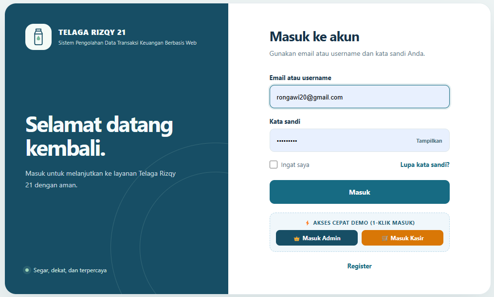
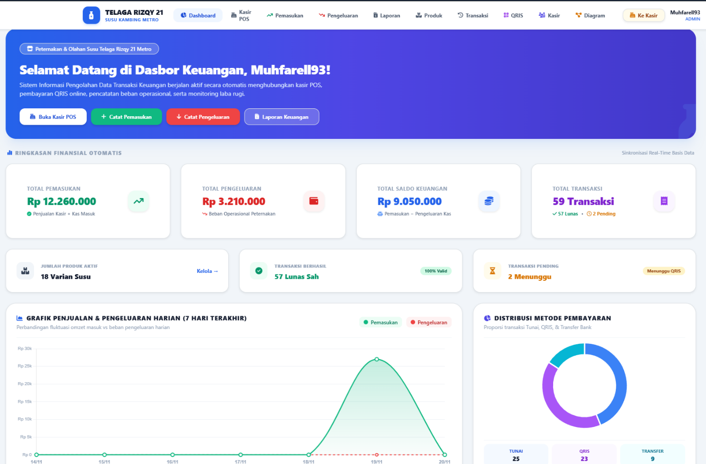
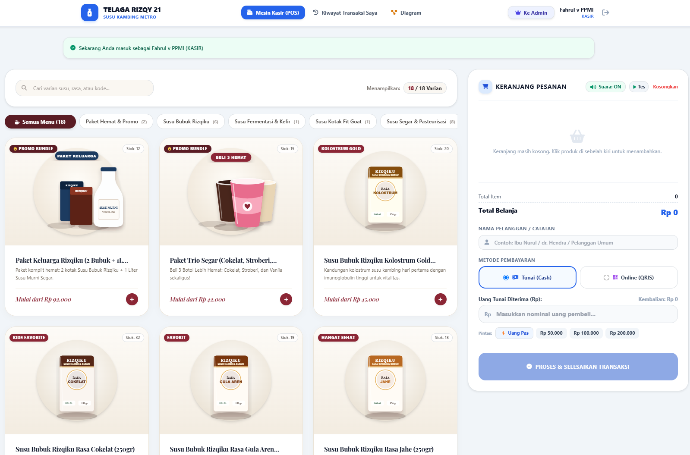
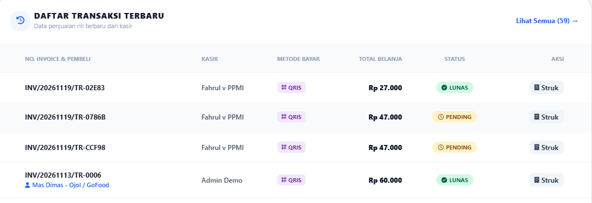
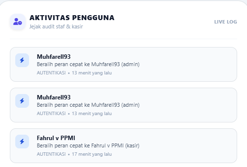
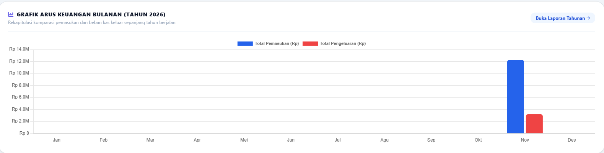
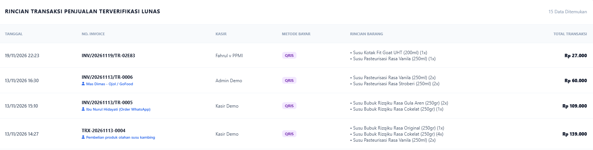
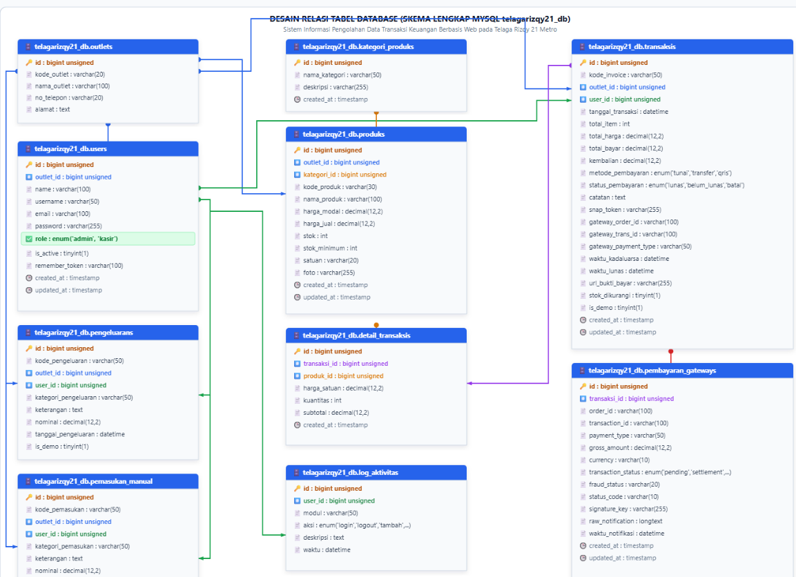

# SISTEM INFORMASI PENGOLAHAN DATA TRANSAKSI KEUANGAN BERBASIS WEB PADA TELAGA RIZQY 21

<p align="center">
  
</p>

<p align="center">
  <strong>Laporan Ini Dibuat Untuk Memenuhi Mata Kuliah Basis Data Lanjut</strong><br>
  <strong>Dosen Pengampu : Dedi Irawan, M.T.I</strong>
</p>

<p align="center">
  
  
  
  
  
  
  
</p>

---

## 👨‍🎓 Disusun Oleh

| Informasi | Keterangan |
| :--- | :--- |
| **Nama Lengkap** | **M. FAHRUL RAJAB FIRDAUS** |
| **NPM** | **24430011** |
| **Kelas** | **SCD 2** |
| **Program Studi** | S1 Ilmu Komputer |
| **Fakultas** | Fakultas Ilmu Komputer (FIKOM) |
| **Perguruan Tinggi** | Universitas Muhammadiyah Metro |
| **Tahun Akademik** | 2026 |

---

## 📝 Catatan / Abstrak

**Telaga Rizqy 21** merupakan salah satu unit usaha yang bergerak di bidang penjualan dan produksi olahan susu kambing (susu kambing bubuk, susu pasteurisasi segar, dan susu formula kolostrum) yang berlokasi di Kota Metro, Lampung. Saat ini, proses pencatatan transaksi keuangan dan penjualan masih dilakukan secara manual menggunakan kalkulator dan buku catatan. Hal ini menyebabkan sering terjadinya kesalahan pencatatan (*human error*), lambatnya pembuatan laporan keuangan, serta kurang optimalnya pelayanan konsumen.

Penelitian ini bertujuan untuk merancang dan membangun sistem informasi pengolahan data transaksi keuangan berbasis web yang dapat mempermudah proses transaksi, pencatatan data, dan pembuatan laporan keuangan secara *real-time*. Metode pengembangan sistem yang digunakan adalah *System Development Life Cycle* (SDLC) dengan model *Waterfall*. Sistem ini dibangun menggunakan bahasa pemrograman PHP, basis data MySQL, antarmuka modern, dan arsitektur web terstruktur.

Hasil dari penelitian ini berupa aplikasi *Point of Sale* (POS) kasir berbasis web yang dilengkapi fitur *dashboard* monitoring finansial otomatis, manajemen stok varian olahan susu, notifikasi suara kasir digital, serta integrasi metode pembayaran Tunai (Cash) dan QRIS (Midtrans). Sistem ini terbukti mampu meningkatkan efisiensi operasional dan meminimalisir kesalahan pencatatan transaksi.

> **Kata Kunci:** Sistem Informasi, Transaksi Keuangan, Point of Sale (POS), MySQL, Telaga Rizqy 21.

---

## I. PENDAHULUAN

### A. Latar Belakang
Perkembangan teknologi informasi saat ini menuntut setiap pelaku usaha untuk beradaptasi, termasuk Usaha Mikro, Kecil, dan Menengah (UMKM). **Telaga Rizqy 21** merupakan salah satu usaha di Kota Metro yang menjual berbagai varian produk olahan susu kambing, seperti susu bubuk aneka rasa, kolostrum, dan paket keluarga.

Berdasarkan hasil observasi, proses bisnis yang berjalan saat ini masih menggunakan sistem manual:
1. Pencatatan transaksi menggunakan kalkulator dagang dan nota kertas seringkali menyebabkan data tidak valid dan laporan keuangan bulanan menjadi tertunda.
2. Proses rekapitulasi data penjualan membutuhkan waktu lama sehingga pemilik usaha kesulitan memantau laba rugi secara *real-time*.
3. Stok barang tidak terpantau otomatis sehingga kasir sering tidak mengetahui jika stok produk telah menipis.

Berdasarkan permasalahan tersebut, diperlukan solusi berupa sistem informasi berbasis web yang mengintegrasikan proses kasir POS, pencatatan pengeluaran, penerimaan pembayaran digital, dan laporan laba rugi secara otomatis, cepat, dan akurat.

### B. Rumusan Masalah
Bagaimana merancang dan membangun **Sistem Informasi Pengolahan Data Transaksi Keuangan Berbasis Web pada Telaga Rizqy 21** yang dapat mengatasi kesalahan pencatatan manual serta menyajikan laporan keuangan secara otomatis dan *real-time*?

### C. Tujuan Penelitian
Merancang dan mengimplementasikan aplikasi sistem informasi penjualan dan keuangan berbasis web untuk mempermudah proses transaksi kasir, pencatatan arus kas masuk dan keluar, serta pembuatan laporan keuangan pada Telaga Rizqy 21.

---

## II. METODE PENELITIAN

Penelitian ini menggunakan pendekatan kualitatif dengan teknik pengumpulan data:
* **Observasi:** Mengamati langsung alur pelayanan kasir dan pembukuan di outlet Telaga Rizqy 21 Metro.
* **Wawancara:** Tanya jawab dengan pemilik usaha dan staf kasir terkait kendala teknis sistem manual.
* **Studi Pustaka:** Mengkaji literatur basis data, diagram relasi, rekayasa perangkat lunak, dan payment gateway.

Metode pengembangan sistem menggunakan **SDLC (System Development Life Cycle) Model Waterfall**:
```
Analisis Kebutuhan ──► Perancangan Desain (UI/UX & DB) ──► Pengkodean (Coding) ──► Pengujian (Blackbox Testing)
```
Sistem dibangun menggunakan bahasa pemrograman **PHP 8.1+**, basis data **MySQL**, framework modern, dan styling antarmuka responsif.

---

## III. HASIL DAN PEMBAHASAN

Sistem informasi pengolahan data transaksi keuangan Telaga Rizqy 21 memiliki dua hak akses (*multi-role*), yaitu **Admin** dan **Kasir**. Berikut adalah dokumentasi implementasi antarmuka (*User Interface*) sistem:

### 1. Halaman Login (Autentikasi Multi-Role)
Pintu masuk utama sistem dengan validasi keamanan email/username dan kata sandi. Dilengkapi pintasan akses cepat (*demo button*) untuk pengujian login instan.

<p align="center">
  
  <br><em>Gambar 1. Halaman Login Sistem</em>
</p>

---

### 2. Dashboard Admin (Monitoring Keuangan Real-Time)
Dirancang untuk pemilik usaha guna memantau kondisi finansial secara komprehensif. Menampilkan:
* **Kartu Metrik Finansial:** Total Pemasukan, Total Pengeluaran, Saldo Keuangan Bersih, dan Jumlah Transaksi.
* **Grafik Penjualan:** Fluktuasi arus kas harian 7 hari terakhir dan diagram lingkaran distribusi metode pembayaran (Tunai, QRIS, Transfer).
* **Aksi Cepat:** Pintasan navigasi ke kasir POS, input pemasukan, dan input pengeluaran.

<p align="center">
  
  <br><em>Gambar 2. Tampilan Dashboard Admin</em>
</p>

---

### 3. Mesin Kasir / POS (Point of Sale) Modern
Antarmuka pelayanan kasir bergaya kafe modern dengan fitur:
* **Katalog 18 Varian Olahan Susu:** Menampilkan foto produk, badge promo (*Best Seller, Superfood, Promo Bundle*), harga satuan, dan sisa stok.
* **Keranjang Interaktif:** Tambah/kurang kuantitas item secara taktil.
* **Dual Payment:** Mendukung Tunai (Cash) dengan kalkulasi kembalian otomatis serta QRIS Digital (Midtrans).
* **Notifikasi Suara Kasir:** Bunyi lonceng kasir *"Ting!"* & *"Cha-Ching!"* otomatis saat pembayaran berhasil.

<p align="center">
  
  <br><em>Gambar 3. Tampilan Mesin Kasir (POS)</em>
</p>

---

### 4. Daftar Transaksi Terbaru (Monitoring Kasir)
Menampilkan data penjualan secara *real-time* langsung dari kasir:
* **Identitas Pembeli:** Nama konsumen atau catatan pesanan (Ojol, WhatsApp, Pelanggan Umum).
* **Indikator Status:** Label visual `LUNAS` (hijau) dan `PENDING` (kuning).
* **Aksi Cepat Struk:** Tombol untuk membuka dan mencetak nota bukti transaksi.

<p align="center">
  
  <br><em>Gambar 4. Tampilan Daftar Transaksi Terbaru</em>
</p>

---

### 5. Log Aktivitas Pengguna (Audit Trail Keamanan)
Mencatat jejak digital setiap aksi penting staf dan kasir (login, beralih peran, simpan data) lengkap dengan stempel waktu (*timestamp*) untuk mencegah penyalahgunaan akun.

<p align="center">
  
  <br><em>Gambar 5. Tampilan Log Aktivitas Pengguna</em>
</p>

---

### 6. Grafik Arus Keuangan Bulanan
Menyajikan komparasi visual arus kas tahunan (*bar chart*) antara Total Pemasukan dan Total Pengeluaran sepanjang 12 bulan berjalan untuk mempermudah evaluasi laba rugi.

<p align="center">
  
  <br><em>Gambar 6. Tampilan Grafik Arus Keuangan Bulanan</em>
</p>

---

### 7. Laporan Rincian Transaksi Penjualan Terverifikasi
Laporan spesifik yang merinci setiap nota transaksi yang telah lunas, mencakup tanggal transaksi, nomor invoice, nama kasir, metode bayar, rincian barang, dan total nilai transaksi.

<p align="center">
  
  <br><em>Gambar 7. Tampilan Rincian Transaksi Penjualan Terverifikasi</em>
</p>

---

### 8. Perancangan Basis Data (Database Relasional)
Sistem menggunakan database MySQL `telagarizqy21_db` dengan integritas relasi *Foreign Key* (1-to-N) yang telah ternormalisasi:
* `outlets`: Data cabang peternakan dan kontak outlet.
* `users`: Akun otentikasi dengan peran murni `enum('admin', 'kasir')`.
* `kategori_produks` & `produks`: Master varian susu kambing, harga modal, harga jual, dan kontrol stok.
* `transaksis` & `detail_transaksis`: Header penjualan dan rincian item per nota.
* `pengeluarans` & `pemasukan_manual`: Pencatatan kas operasional non-penjualan.
* `pembayaran_gateways`: Log transaksi digital gateway Midtrans.
* `log_aktivitas`: Catatan jejak audit sistem.

<p align="center">
  
  <br><em>Gambar 8. Skema Relasi Tabel Database Sistem</em>
</p>

---

### 9. Pengujian Sistem (Blackbox Testing)
Pengujian fungsionalitas menggunakan metode *Blackbox Testing* menunjukkan seluruh fungsi berjalan **100% valid**:
* Validasi autentikasi hak akses Admin dan Kasir.
* Validasi kalkulasi keranjang, subtotal, dan kembalian tunai.
* Validasi pemotongan stok otomatis saat pembayaran terkonfirmasi.
* Validasi filter status transaksi QRIS dan sinkronisasi webhook.

---

## IV. KESIMPULAN DAN SARAN

### A. Kesimpulan
1. Sistem Informasi Pengolahan Data Transaksi Keuangan Berbasis Web pada Telaga Rizqy 21 berhasil dirancang dan diimplementasikan.
2. Fitur Kasir POS mempermudah pelayanan transaksi dengan kalkulasi kembalian otomatis, notifikasi suara digital, dan pemotongan stok secara *real-time*.
3. Sistem berhasil mengeliminasi kesalahan hitung manual (*human error*) serta menyajikan rekapitulasi laba rugi dan laporan keuangan secara akurat.

### B. Saran
1. Integrasi pengembangan lebih lanjut dengan layanan kurir/logistik ekspedisi untuk pengiriman susu kambing ke luar kota.
2. Pengembangan aplikasi *mobile* berbasis Android/iOS bagi konsumen langsung untuk pemesanan susu secara mandiri (*self-order*).

---

## 🌐 V. HOSTING OTOMATIS CLOUDFLARE (LIVE DATABASE & .ENV 100% OTOMATIS)

Sistem ini telah dilengkapi fitur **Hosting Otomatis Cloudflare (Cloudflare Tunnel)** yang menghubungkan aplikasi web, database MySQL (`telagarizqy21_db`), serta seluruh konfigurasi `.env` ke jaringan global Cloudflare dengan enkripsi resmi **HTTPS**. Fitur ini berjalan **100% otomatis tanpa konfigurasi manual**, sehingga dapat langsung dibuka oleh dosen penguji atau publik dari mana saja di seluruh dunia.

### 🔗 Tautan Publik Cloudflare (Live):
👉 **[https://substitute-donor-they-poet.trycloudflare.com](https://substitute-donor-they-poet.trycloudflare.com)**  
*(Dapat langsung diakses dari browser HP, tablet, atau laptop manapun di seluruh dunia).*

### ⚡ Cara Mengaktifkan Hosting Cloudflare (1-Klik Tanpa Manual):
1. Buka folder proyek ini di Windows Explorer: `c:\Users\advan\Documents\Skripsi kating\`
2. Klik ganda (*double click*) berkas:
   👉 **`HOSTING_CLOUDFLARE_OTOMATIS.bat`**
3. Sistem secara otomatis:
   * Mengaktifkan server web lokal port 8000.
   * Mengaktifkan *terowongan jaringan* Cloudflare (`cloudflared`).
   * Menghubungkan database MySQL `telagarizqy21_db` dan file `.env` secara langsung.
   * Menampilkan link publik Cloudflare aktif yang siap dibagikan.

### 💾 Berkas Migrasi Database & File ENV Otomatis:
Jika Anda ingin memindahkan database ke server hosting MySQL lainnya di kemudian hari, berkas berikut sudah otomatis diekspor:
* **Database Dump Siap Pakai (13 Tabel Lengkap):** [`database_telagarizqy21_live_dump.sql`](file:///c:/Users/advan/Documents/Skripsi%20kating/database_telagarizqy21_live_dump.sql)
* **Konfigurasi Environment Produksi:** [`.env.production`](file:///c:/Users/advan/Documents/Skripsi%20kating/laravel-app/.env.production)

---

## ☁️ VI. PANDUAN HOSTING ALTERNATIF DI VERCEL

Aplikasi ini telah dikonfigurasi penuh dengan berkas `vercel.json` dan bridge serverless `api/index.php` sehingga dapat di-deploy ke **Vercel** secara gratis agar bisa diakses oleh dosen penguji atau publik dari mana saja tanpa perlu menyalakan komputer lokal:

### Langkah-Langkah Deploy ke Vercel:
1. **Buka Vercel:** Kunjungi [https://vercel.com](https://vercel.com) dan login menggunakan akun GitHub Anda (`muhfarell93-tech`).
2. **Impor Proyek:**
   * Klik tombol **"Add New..."** ➔ **"Project"**.
   * Cari dan pilih repositori: `muhfarell93-tech/skripsi-telagarizqy21`.
   * Klik **"Import"**.
3. **Konfigurasi Environment Variables:**
   Pada menu dropdown **Environment Variables**, tambahkan variabel berikut:
   | Key | Value (Contoh) | Keterangan |
   | :--- | :--- | :--- |
   | `APP_NAME` | `Telaga Rizqy 21` | Nama aplikasi |
   | `APP_ENV` | `production` | Lingkungan produksi |
   | `APP_KEY` | `base64:lE/MLHM/eCfkYWc85mmmj52k3og9nDhrozm8F57uF0M=` | Kunci enkripsi Laravel |
   | `APP_DEBUG` | `false` | Mode produksi aman |
   | `APP_URL` | `https://skripsi-telagarizqy21.vercel.app` | URL domain Vercel Anda |
   | `DB_CONNECTION`| `mysql` | Tipe basis data |
   | `DB_HOST` | *(Host Cloud Database)* | Contoh: dari TiDB Serverless / Aiven / Railway |
   | `DB_PORT` | `3306` | Port database MySQL |
   | `DB_DATABASE`| `telagarizqy21_db` | Nama database cloud |
   | `DB_USERNAME`| *(User Database Cloud)* | Username cloud database |
   | `DB_PASSWORD`| *(Password Database Cloud)* | Kata sandi database cloud |

4. **Deploy:** Klik tombol **"Deploy"**. Dalam 1-2 menit, aplikasi Anda sudah live dengan URL publik HTTPS yang dapat dibuka di seluruh dunia!

> **Tips Cloud Database Gratis:** Anda dapat membuat database MySQL online gratis seumur hidup di platform seperti **TiDB Cloud (Serverless MySQL)**, **Aiven.io**, atau **Railway.app** lalu mengimpor berkas `database_telaga_rizqy21_fixed.sql`.

---

## 📱 VII. CARA MEMASANG SEPERTI APK DI ANDROID & DESKTOP (PWA)

Sistem ini telah mendukung standar **Progressive Web App (PWA)** dengan berkas `manifest.json` dan `sw.js` (Service Worker). Pengguna dapat memasang sistem ini langsung menjadi **aplikasi standalone di HP Android (berfungsi layaknya file APK)**:

### 1. Pemasangan di HP Android (Google Chrome):
1. Buka tautan web sistem di browser Google Chrome pada smartphone Anda.
2. Ketuk ikon titik tiga (⋮) di pojok kanan atas browser.
3. Pilih opsi **"Tambahkan ke Layar Utama"** (*Add to Home screen*) atau **"Instal Aplikasi"**.
4. Ikon aplikasi **Telaga Rizqy 21** akan otomatis muncul di layar HP layaknya aplikasi APK native tanpa bilah alamat browser (*full-screen app*).

### 2. Pemasangan di Komputer / Laptop (Windows):
1. Buka tautan web di browser Chrome atau Microsoft Edge.
2. Klik ikon monitor kecil bertanda panah (**"Install App"**) pada sisi kanan bilah alamat (URL bar).
3. Aplikasi akan terpasang di Desktop Windows dan dapat dibuka sebagai jendela aplikasi terpisah.

---

## ⚡ VIII. CARA MENJALANKAN STANDALONE TANPA MEMBUKA LARAGON & ANTIGRAVITY

Bagi dosen penguji atau rekan yang mengunduh berkas proyek ini di laptop Windows dan **tidak ingin repot membuka Laragon maupun Antigravity**, cukup gunakan pintasan otomatis berikut:

1. Buka folder proyek ini di Windows Explorer: `c:\Users\advan\Documents\Skripsi kating\`
2. Klik ganda (*double click*) file:
   👉 **`JALANKAN_APLIKASI.bat`**
3. Server lokal dan browser kasir POS akan terbuka secara otomatis dalam 2 detik:
   * **URL:** `http://localhost:8000/pos`

---

## 🚀 IX. PANDUAN MENJALANKAN APLIKASI SECARA MANUAL (LOCAL SETUP)

### Prasyarat Sistem:
* **Web Server & PHP:** Laragon / XAMPP (PHP versi 8.1 atau lebih baru)
* **Database:** MySQL / MariaDB (port 3306)
* **Composer:** Versi 2.x

### Langkah Instalasi:
```bash
# 1. Masuk ke direktori aplikasi
cd "c:/Users/advan/Documents/Skripsi kating/laravel-app"

# 2. Salin environment file & generate key
copy .env.example .env
php artisan key:generate

# 3. Jalankan migrasi dan seeder database
php artisan migrate --seed

# 4. Jalankan development server
php artisan serve --port=8000
```
Buka browser pada tautan: **[http://localhost:8000](http://localhost:8000)**

### Kredensial Akun Pengujian:
* **Akun Admin:** Username `demo.admin` | Password `password`
* **Akun Kasir:** Username `demo.kasir` | Password `password`

---

<p align="center">
  <strong>© 2026 M. Fahrul Rajab Firdaus (NPM: 24430011) — Universitas Muhammadiyah Metro</strong>
</p>
